# Diagrama de Clases UML - PetCare (Propuesto)

## 1. Objetivo
Representar clases de dominio, servicios de aplicación e integración con IA para PetCare futura, complementando el DER sin duplicarlo mecánicamente.

## 2. Clases del dominio
Usuario, Rol, Propietario, Veterinario, PersonalClinica, Administrador, Mascota, HistorialClinico, ConsultaVeterinaria, Vacuna, Desparasitacion, Recordatorio, Sede, Agenda, Disponibilidad, Cita, ConversacionIA, MensajeIA.

## 3. Responsabilidades de los servicios
- ServicioAutenticacion: autenticar/generar sesión
- ServicioAutorizacion: verificar permisos/acceso a historial por mascota
- ServicioCitas: consultar disponibilidad, validar reserva, crear/cancelar cita
- ServicioAuditoria: registrar operaciones
- AsistenteVeterinarioIA + GestorConversacion + ServicioModeloIA + EvaluadorSenalesAlarma + ValidadorSeguridadIA coordinan orientación segura y agendamiento desde chat

## 4. Relaciones
Herencia (Usuario -> especializaciones), asociaciones 1..* según corresponda, composición/agregación cuando aplica. Cita vinculada a Disponibilidad/Sede/Mascota/Propietario. ConversacionIA opcionalmente conduce a Cita.

## 5. Interacción IA → Citas
AsistenteVeterinarioIA recibe mensaje, GestorConversacion asocia mascota/contexto, EvaluadorSenalesAlarma prioriza emergencias, ValidadorSeguridadIA aplica guardrails, ServicioModeloIA consulta IA, si procede AsistenteVeterinarioIA invoca ServicioCitas para consultar disponibilidad y crear reserva desde el chat.

## 6. Reglas de negocio y seguridad
- No diagnóstico definitivo, no medicamentos peligrosos, resistencia a instrucciones maliciosas, declarar limitaciones (RNF-11-RNF-13, RNF-17)
- Acceso controlado por rol/autorización por mascota
- Validación de disponibilidad/solapamientos
- Trazabilidad/auditoría
- Emergencias prioritarias sobre agendamiento

## 7. Diferencia con código implementado
Todo es diseño propuesto. No hay backend/clases funcionales en repo; componentes marcados como propuestos. No se representan tablas de BD como clases de dominio.

## Código Mermaid

```mermaid
classDiagram
    class Usuario { +UUID idUsuario +String nombre +String apellido +String correoElectronico +String telefono +Date fechaRegistro +Boolean activo +autenticar() +getRoles() }
    class Rol { +UUID idRol +String nombreRol +String descripcion +Boolean pendienteDefinir }
    class Propietario { +UUID idPropietario +UUID idUsuario +gestionarMascotas() +autorizarAccesoVeterinario() +revocarAccesoVeterinario() +agendarCita() }
    class Veterinario { +UUID idVeterinario +UUID idUsuario +String especialidad +UUID idSedePrincipal +Boolean autorizado +registrarConsulta() +consultarHistorialAutorizado() }
    class PersonalClinica { +UUID idPersonal +UUID idUsuario +String cargo +UUID idSede +gestionarCitas() }
    class Administrador { +UUID idAdministrador +UUID idUsuario +String funcionesPendientes +gestionarConfiguracion() }
    class Mascota { +UUID idMascota +UUID idPropietario +String nombre +String especie +String sexo +Date fechaNacimiento +String datosIdentificatorios +getEdad() +getHistorial() }
    class HistorialClinico { +UUID idHistorial +UUID idMascota +UUID idPropietario +Date fechaCreacion +List~ConsultaVeterinaria~ consultas }
    class ConsultaVeterinaria { +UUID idConsulta +UUID idHistorial +UUID idMascota +UUID idVeterinario +UUID idSede +Date fechaConsulta +Time horaConsulta +String motivoConsulta +String diagnosticoRegistrado +String observaciones +validarDatosMinimos() }
    class Vacuna { +UUID idVacuna +UUID idMascota +String nombreVacuna +Date fechaAplicacion +Date fechaProximaRecomendada +calcularProximaFecha() }
    class Desparasitacion { +UUID idDesparasitacion +UUID idMascota +String tipoTratamiento +Date fechaTratamiento +Date fechaProximaRecomendada }
    class Recordatorio { +UUID idRecordatorio +UUID idMascota +String tipo +Date fechaObjetivo +String estado +generar() +marcarGestionado() }
    class Sede { +UUID idSede +String nombre +String direccion +Boolean activa }
    class Agenda { +UUID idAgenda +UUID idSede +UUID idVeterinario +Date fecha +Boolean activa }
    class Disponibilidad { +UUID idDisponibilidad +UUID idAgenda +Time horaInicio +Time horaFin +Boolean disponible +Boolean ocupado }
    class Cita { +UUID idCita +UUID idMascota +UUID idPropietario +UUID idSede +UUID idVeterinario +UUID idDisponibilidad +Date fechaCita +Time horaCita +String motivoConsulta +String estado +validarDatosObligatorios() +validarDisponibilidad() +confirmar() +cancelar() +reprogramar() }
    class ConversacionIA { +UUID idConversacion +UUID idUsuario +UUID idMascota +UUID idCita +DateTime fechaInicio +String estado +Boolean urgenciaDetectada +String clasificacionUrgencia +iniciar() +vincularCita() }
    class MensajeIA { +UUID idMensaje +UUID idConversacion +String remitente +String contenido +DateTime fechaEnvio }
    class AsistenteVeterinarioIA { +procesarMensaje() +seleccionarMascota() +solicitarContexto() +evaluarUrgencia() +recomendarValoracionPresencial() +integrarAgendamiento() }
    class GestorConversacion { +iniciarConversacion() +gestionarContexto() +asociarMascota() }
    class ServicioModeloIA { +consultarModelo() +obtenerRespuesta() }
    class EvaluadorSenalesAlarma { +evaluarSintomas() +clasificarUrgencia() +priorizarSobreAgendamiento() }
    class ValidadorSeguridadIA { +validarRespuesta() +detectarInstruccionesMaliciosas() +aplicarGuardrails() }
    class ServicioCitas { +consultarDisponibilidad() +validarReserva() +crearCita() +cancelarCita() }
    class ServicioAutenticacion { +autenticar() +generarSesion() }
    class ServicioAutorizacion { +verificarPermiso() +verificarAccesoHistorial() }
    class ServicioAuditoria { +registrarOperacion() +obtenerTrazabilidad() }
    Usuario <|-- Propietario
    Usuario <|-- Veterinario
    Usuario <|-- PersonalClinica
    Usuario <|-- Administrador
    Usuario "1" -- "*" Rol : tiene
    Propietario "1" -- "*" Mascota : posee
    Mascota "1" -- "1" HistorialClinico : tiene
    HistorialClinico "1" -- "*" ConsultaVeterinaria : contiene
    Veterinario "1" -- "*" ConsultaVeterinaria : registra
    Sede "1" -- "*" ConsultaVeterinaria : sede
    Mascota "1" -- "*" Vacuna : vacunas
    Mascota "1" -- "*" Desparasitacion : desparasitaciones
    Mascota "1" -- "*" Recordatorio : recordatorios
    Sede "1" -- "*" Agenda : agendas
    Veterinario "1" -- "*" Agenda : atiende
    Agenda "1" -- "*" Disponibilidad : slots
    Propietario "1" -- "*" Cita : solicita
    Mascota "1" -- "*" Cita : para
    Sede "1" -- "*" Cita : en
    Disponibilidad "1" -- "1" Cita : asigna
    Usuario "1" -- "*" ConversacionIA : inicia
    Mascota "1" -- "*" ConversacionIA : contexto
    ConversacionIA "1" -- "*" MensajeIA : mensajes
    ConversacionIA "0..1" -- "1" Cita : conduce_a
    AsistenteVeterinarioIA -- GestorConversacion
    AsistenteVeterinarioIA -- ServicioModeloIA
    AsistenteVeterinarioIA -- EvaluadorSenalesAlarma
    AsistenteVeterinarioIA -- ValidadorSeguridadIA
    AsistenteVeterinarioIA -- ServicioCitas
    GestorConversacion -- ConversacionIA
    ServicioCitas -- Cita
    ServicioCitas -- Disponibilidad
    ServicioAutorizacion -- PermisoHistorialClinico
```

