# Diagrama de Componentes - PetCare (Arquitectura Propuesta)

## 1. Objetivo del diagrama

Modelar la arquitectura lógica propuesta para la futura implementación de PetCare, distinguiendo entre el MVP visual actual (no funcional) y los componentes a construir. Enfocado en el asistente veterinario inteligente con orientación inicial y agendamiento integrado desde el chat, conforme a RF-01 a RF-20 y RNF-01 a RNF-18.

## 2. Estado actual y alcance

- Estado actual: Sin página web funcional ni backend. MVP visual con Google Stitch IA como referencia.
- Alcance: Arquitectura futura con autenticación por roles, gestión clínica, dos sedes, disponibilidad real, asistente IA con orientación segura y agendamiento desde chat.
- Nota: No se afirma que los componentes ya existan.

## 3. Componentes principales

### A. Capa de Presentación
- Módulo de Autenticación e Ingreso
- Panel del Propietario/Tutor
- Interfaz del Veterinario
- Interfaz del Personal de Clínica
- Interfaz Administrativa (permisos pendientes)
- Interfaz Asistente IA + Chat con Agendamiento
- UI Adaptable (Desktop/Tablet/Móvil)

### B. Capa de Aplicación y Servicios de Negocio
- AuthN/AuthZ por Roles (4 roles)
- Gestión de Usuarios y Permisos
- Gestión de Mascotas y Propietarios (RF-01)
- Historial Clínico y Consultas (RF-02, RF-04)
- Vacunas, Desparasitaciones y Recordatorios (RF-06, RF-07, RF-08)
- Gestión de Citas / Sedes / Disponibilidad / Reserva (RF-05, RF-14-RF-19)
- Trazabilidad y Auditoría
- Validación Reglas de Negocio

### C. Capa del Asistente Veterinario Inteligente
- Orquestador del Asistente IA
- Gestión de Contexto Mascota/Motivo (RF-09, RF-10)
- Triage / Señales de Alarma / Urgencia (RF-12)
- Guardrails / Seguridad / Validación Respuestas (RNF-11-RNF-13)
- Servicio LLM externo por definir
- Integración Chat→Citas (Agendamiento) (RF-13, RF-15)
- Escalamiento/Derivación (Pendiente) (RF-20)

### D. Capa de Datos y Persistencia
- Base de datos por definir (tecnología pendiente)
- Repositorio Usuarios/Roles/Permisos
- Repositorio Mascotas/Historial/Consultas
- Repositorio Citas/Sedes/Disponibilidad
- Repositorio Auditoría/Conversaciones* (*persistencia pendiente)

### E. Servicios Externos e Infraestructura
- Proveedor LLM (Sin definir)
- Servicio Notificaciones (Pendiente definición)

## 4. Relaciones principales
- Presentación -> Aplicación (autenticación/autorización)
- Chat IA -> Orquestador IA
- Orquestador IA -> LLM (vía guardrails)
- IA -> Gestión de Citas (consulta disponibilidad, solicitud de reserva desde chat)
- Citas valida sede/mascota/tutor/motivo/horario/datos obligatorios y evita solapamientos
- Citas visibles a tutor y personal autorizado; cambios auditados

## 5. Flujo IA + Agendamiento desde el chat
1. Selección de mascota y contexto (RF-09)
2. Motivo de consulta (RF-10)
3. Orientación inicial sin diagnóstico definitivo (RF-11)
4. Triage: emergencias tienen prioridad sobre agendamiento (RF-12)
5. Recomendación justificada de valoración presencial + opción agendar (RF-13)
6. Presentación de dos sedes y disponibilidad real (RF-14)
7. Agendamiento integrado, validación y confirmación (RF-15-RF-17)
8. Cita visible en módulos autorizados (RF-18)
9. Errores/disponibilidad/cancelación sin reservas duplicadas (RF-19)

## 6. Seguridad y protección de datos
- Acceso por roles, autorización por mascota
- Credenciales seguras, integridad y trazabilidad
- Privacidad IA (mínimo necesario), guardrails, transparencia
- Prevención de recomendaciones peligrosas, protección contra instrucciones maliciosas
- Validación de agenda, manejo de errores

## 7. Correspondencia con requisitos
Cubre RF-01 a RF-20 y RNF-01 a RNF-18 según secciones anteriores.

## 8. Supuestos y decisiones pendientes
- Motor BD: pendiente (no definido)
- Proveedor LLM: pendiente (sin definir)
- Persistencia conversaciones IA: pendiente
- Aprobación citas desde chat vs directa: pendiente
- Origen disponibilidad real: pendiente
- Escalamiento humano: pendiente
- Políticas IA datos sensibles: pendiente
- Permisos rol Administrador: pendiente
- Servicio notificaciones: pendiente
- Integración calendario externo: no justificada

## 9. Código Mermaid

```mermaid
graph TD
  subgraph Capa_Presentacion["A. CAPA DE PRESENTACIÓN (Futura)"]
    AuthUI["Módulo Autenticación e Ingreso"]
    TutorUI["Panel Propietario/Tutor"]
    VetUI["Interfaz Veterinario"]
    ClinicUI["Interfaz Personal de Clínica"]
    AdminUI["Interfaz Administrativa"]
    AIChatUI["Interfaz Asistente IA + Chat con Agendamiento"]
    ResponsiveUI["UI Adaptable Desktop/Tablet/Móvil"]
  end
  subgraph Capa_Aplicacion["B. CAPA DE APLICACIÓN Y SERVICIOS DE NEGOCIO"]
    AuthZ["AuthN/AuthZ por Roles (4 roles)"]
    UsersSvc["Gestión Usuarios y Permisos"]
    PetsSvc["Gestión Mascotas y Propietarios"]
    ClinicSvc["Historial Clínico y Consultas"]
    PreventiveSvc["Vacunas, Desparasitaciones y Recordatorios"]
    ApptSvc["Gestión de Citas / Sedes / Disponibilidad / Reserva"]
    AuditSvc["Trazabilidad y Auditoría"]
    ValidationSvc["Validación Reglas de Negocio"]
  end
  subgraph Capa_IA["C. CAPA DEL ASISTENTE VETERINARIO INTELIGENTE"]
    AIOrch["Orquestador del Asistente IA"]
    AIContext["Gestión de Contexto Mascota/Motivo"]
    AITriage["Triage / Señales de Alarma / Urgencia"]
    AIGuard["Guardrails / Seguridad / Validación Respuestas"]
    LLMInt["Servicio LLM externo por definir"]
    AIBooking["Integración Chat→Citas (Agendamiento)"]
    AIEscal["Escalamiento/Derivación (Pendiente)"]
  end
  subgraph Capa_Datos["D. CAPA DE DATOS Y PERSISTENCIA"]
    DBMain["Base de datos por definir (Tecnología pendiente)"]
    RepoUsers["Repositorio Usuarios/Roles/Permisos"]
    RepoClinic["Repositorio Mascotas/Historial/Consultas"]
    RepoAppt["Repositorio Citas/Sedes/Disponibilidad"]
    RepoAudit["Repositorio Auditoría/Conversaciones*"]
  end
  subgraph Capa_Externos["E. SERVICIOS EXTERNOS E INFRAESTRUCTURA"]
    ExtLLM["Proveedor LLM (Sin definir)"]
    ExtNotif["Servicio Notificaciones (Pendiente definición)"]
  end
  AuthUI --> AuthZ
  AIChatUI --> AIOrch
  AIOrch --> LLMInt
  LLMInt --> ExtLLM
  AIBooking --> ApptSvc
  AIOrch --> AIBooking
  AITriage -.->|PRIORIDAD: Emergencias sobre agendamiento| AIOrch
  ApptSvc --> RepoAppt
  ClinicSvc --> RepoClinic
  AuthZ --> RepoUsers
  AuditSvc --> RepoAudit
```

