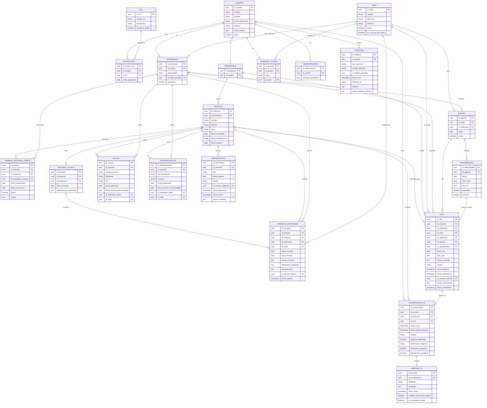

# Diagrama Entidad-Relación - PetCare (Propuesto)

## 1. Objetivo del modelo de datos
Representar la estructura de datos propuesta para PetCare (futura implementación), cubriendo usuarios/roles/permisos, mascotas, historial clínico/consultas, vacunas/desparasitaciones/recordatorios, sedes/agenda/disponibilidad/citas, conversaciones IA, y auditoría. Diferencia entre MVP visual (no funcional) y diseño propuesto.

## 2. Entidades y atributos principales
Ver archivo .mmd con entidades: USUARIO, ROL, USUARIO_ROL, PROPIETARIO, VETERINARIO, PERSONAL_CLINICA, ADMINISTRADOR, SEDE, MASCOTA, PERMISO_HISTORIAL_CLINICO, HISTORIAL_CLINICO, CONSULTA_VETERINARIA, VACUNA, DESPARASITACION, RECORDATORIO, AGENDA, DISPONIBILIDAD, CITA, CONVERSACION_IA, MENSAJE_IA, AUDITORIA.

## 3. Claves primarias y foráneas
- PK: uuid como identificador principal en entidades
- FK: relaciones entre entidades (usuario-rol, mascota-propietario, consulta-mascota/veterinario/sede, cita-disponibilidad/agenda, etc.)

## 4. Relaciones y cardinalidades
- Usuario 1:N UsuarioRol N:1 Rol
- Usuario 1:0..1 especializaciones (Propietario/Veterinario/Personal/Administrador)
- Propietario 1:N Mascota
- Mascota 1:1 HistorialClinico, 1:N Consultas/Vacunas/Desparasitaciones/Recordatorios/Citas
- Veterinario autorizado via PERMISO_HISTORIAL_CLINICO (por mascota)
- Sede 1:N Agenda/Personal/Citas
- Agenda 1:N Disponibilidad
- Disponibilidad 1:1 Cita (evita doble asignación)
- ConversacionIA 1:N MensajeIA, 0..1 -> 1 Cita
- Auditoria N:1 Usuario

## 5. Citas, sedes y disponibilidad
- SEDE representa las dos sedes (flag es_una_de_dos_sedes)
- AGENDA por sede/veterinario/fecha
- DISPONIBILIDAD con hora_inicio/fin, disponible/ocupado
- CITA vincula mascota, propietario, sede, veterinario, agenda, disponibilidad con estado/fechas
- Validación para evitar solapados/duplicados (reglas de negocio)

## 6. Conversaciones con IA
- CONVERSACION_IA asociada a usuario y mascota válida; opcionalmente a CITA
- MENSAJE_IA almacena intercambio
- Campos urgencia_detectada/clasificacion_urgencia/derivacion_requerida
- persistencia_pendiente: política de almacenamiento no definida (no forzar almacenamiento permanente)

## 7. Restricciones de integridad y seguridad
- Permisos por mascota (PERMISO_HISTORIAL_CLINICO) con fecha_autorizacion/revocacion/activo
- Solo veterinarios autorizados acceden a historial
- Auditoría centralizada (AUDITORIA) registra operaciones críticas
- No almacenar diagnósticos definitivos de IA como registros veterinarios
- Datos clínicos protegidos según RNF-01 a RNF-03

## 8. Decisiones pendientes sobre persistencia y tecnología
- Motor BD: no definido (Postgres/MySQL/otro) - representar abstracciones
- Persistencia conversaciones IA: pendiente (sesión vs histórico)
- Origen disponibilidad real: agenda clínica/calendario compartido/centralizado - pendiente
- Aprobación citas desde chat: directa o con aprobación - pendiente
- Integración calendario externo: no documentada - no incluir
- Políticas de datos sensibles para IA: pendiente

## Código Mermaid

