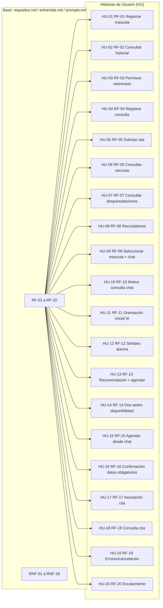

# Historias de Usuario - PetCare (HU-01 a HU-20)

## 1. Objetivo
Documentar las historias de usuario con trazabilidad desde requisitos RF-01 a RF-20, basadas en `docs/Ia/requisitos.md`, `docs/Ia/entrevista.md` y `docs/Ia/prompts.md`. Arquitectura propuesta (MVP visual no funcional).

## 2. Tracabilidad y criterios clave
Ver archivo con criterios Gherkin completo en `historias_usuario_criterios_aceptacion.md`. Este diagrama muestra mapeo RF → HU.

## 3. Prioridades
Must: HU-01 a HU-06, HU-09 a HU-19  
Should: HU-07, HU-08, HU-20

## 4. Principios aplicados
- Control de acceso por rol y autorización por mascota
- Emergencias prioritarias sobre agendamiento
- IA sin diagnóstico definitivo, sin medicamentos peligrosos
- Agendamiento desde chat con disponibilidad real
- Prevención de duplicados, trazabilidad y auditoría
- Sin imponer BD/proveedor LLM/calendario externo

## 5. Diagrama Mermaid

