# PetCare — Diagrama de Componentes, Arquitectura y MCP

**Proyecto:** PetCare — Plataforma web para el cuidado preventivo de mascotas
**Documentos fuente:** `README.md`, `docs/Ia/requisitos.md`, `docs/Ia/entrevista.md`, `docs/Ia/prompts.md`
**Artefacto complementario:** `mi-framework-ia/` (framework de IA propio del proyecto)
**Versión:** 1.0 — propuesta de arquitectura

---

## 0. Resumen ejecutivo

PetCare es una **aplicación web monolítica modular** (SPA responsive + API REST + PostgreSQL) con **cuatro roles**
(propietario, veterinario, personal de clínica, administrador), **dos sedes**, y un subsistema de **c preventive
preventivo** (vacunas/desparasitaciones) con cálculo automático de próxima fecha y generación de recordatorios.

La IA **no es parte del MVP**: el propio README la clasifica como *funcionalidad de expansión (Could)*. Por tanto el
componente de IA se modela como **externo y opcional**, conectado por un adaptador, y se apoya en el framework propio
`mi-framework-ia`.

Se identificaron **7 contradicciones o brechas** entre los documentos (sección 1.7). La más relevante: la matriz de
permisos del README permite al *Personal de Clínica* "Ver" el historial clínico, lo cual **contradice directamente
el RNF-01**.

---

## 1. Análisis de la arquitectura propuesta

### 1.1 Inventario documental analizado

| Documento | Aporta | Estado |
|---|---|---|
| `docs/Ia/requisitos.md` | RF-01…RF-08, RNF-01…RNF-08, HU-01…HU-08, Gherkin (solo HU-01) | Fuente de verdad funcional |
| `docs/Ia/entrevista.md` | 16 secciones de necessities, necesidades clave, alcance inicial, exclusiones | Fuente de verdad de dominio |
| `docs/Ia/prompts.md` | 5 prompts de elicitación + restricciones de alcance | Restricciones de diseño |
| `README.md` | Visión, roles, matriz de permisos, alcance MVP, módulos, capas | Fuente de verdad de alcance funcional |
| `mi-framework-ia/**` | Framework de IA: core, agents, skills, tools, interfaces, config | Componente de IA (aún en scaffolding) |

### 1.2 Actores principales

Extraídos de la matriz de roles del `README.md` y de RF-01…RF-08:

| Actor | Rol en el sistema | Evidencia |
|---|---|---|
| **Propietario** | Registra mascotas, consulta historial, autoriza/revoca veterinarios, solicita citas, recibe recordatorios | RF-01, RF-02, RF-03, RF-05, RF-06, RF-07, RF-08 |
| **Veterinario** | Registra consultas, vacunas y desparasitaciones; consulta historial clínico autorizado | RF-04, RF-06, RNF-01 |
| **Personal de Clínica** (secretaria) | Gestiona agenda, disponibilidad, vencimientos y envío de recordatorios | Entrevista §5, §6, §8, §10; matriz README |
| **Administrador** | Gestiona usuarios, roles, sedes y configuración | Entrevista §7; alcance inicial |

**Fuera del sistema (actores externos):** proveedor de LLM, API de búsqueda web, servicio de envío de email.

### 1.3 Módulos y funcionalidades principales

Consolidando las tres fuentes (README "Módulos del Sistema", alcance inicial de la entrevista y RF/HU):

1. **Autenticación, autorización, usuarios y roles** — RNF-01, RNF-02, RNF-03, RF-03, Entrevista §7/§13
2. **Gestión de mascotas y propietarios** — RF-01, HU-01
3. **Historial clínico** — RF-02, HU-02, RNF-01, RNF-03, Entrevista §3/§4
4. **Registro de consultas veterinarias** — RF-04, HU-04
5. **Vacunas y desparasitaciones** — RF-06, RF-07, HU-06, HU-07
6. **Motor de protocolos preventivos** (cálculo de próxima fecha) — RF-06/RF-07 ("próxima fecha recomendada"), README MVP
7. **Citas y disponibilidad** (agenda, estados, slots) — RF-05, HU-05, Entrevista §5/§6
8. **Recordatorios preventivos** (alertas + reporte semanal) — RF-08, HU-08, Entrevista §2/§8/§9
9. **Notificaciones** (in-app + email) — RF-08, README MVP
10. **Documentos clínicos** (adjuntos de exámenes, fórmulas, resúmenes PDF) — Entrevista §3/§12, README *Should*
11. **Sedes, clínicas y veterinarios** (catálogo multi-sede) — Entrevista §4, alcance inicial
12. **Búsqueda y filtros** — Entrevista §11, alcance inicial
13. **Dashboard e indicadores** — Entrevista §10, alcance inicial
14. **Auditoría y trazabilidad** — RNF-07, Entrevista §13
15. **Respaldo y recuperación** — RNF-08
16. **Lista de espera** — README *Should*
17. **Perfil de emergencia QR** — README *Could* (expansión)
18. **Alertas preventivas con IA** — README *Could* (expansión), Entrevista §9

### 1.4 Dependencias entre módulos

Dependencias **funcionales** (un componente necesita a otro para cumplir su RF):

- `Historial Clínico` ← `Consultas`, `Vacunas/Desparasitaciones`, `Documentos` (se posée y agrega al historial)
- `Vacunas/Desparasitaciones` → `Motor de Protocolos` (necesita el protocolo para calcular la próxima fecha)
- `Citas` → `Historial Clínico` (RF-05 solo tiene sentido sobre una mascota registrada) y → `Sedes/Veterinarios` (RF-05: *la clínica ofrece el horario*)
- `Recordatorios` → `Vacunas/Desparasitaciones` (dispara por "próxima fecha recomendada")
- `Recordatorios` → `Notificaciones` (entrega el aviso)
- `Documentos` → `Historial Clínico` (se asocian a la historia del paciente)
- `Dashboard` → `Citas` + `Vacunas/Desparasitaciones` (indicadores y vencimientos)
- `Lista de Espera` → `Citas` (opcupación de cupos liberados)
- **Todos** → `Autorización` (RNF-01/RNF-03), `Autenticación` (RNF-02), `Auditoría` (RNF-07)

Dependencias **técnicas**: `Frontend → API → Persistencia → PostgreSQL/Object Storage`; `API → Redis` (opcional);
`API → AIServicePort → mi-framework-ia → LLM`.

### 1.5 Información a almacenar, procesar e intercambiar

**Almacenar (PostgreSQL):**

| Entidad | Campos clave | Requisito |
|---|---|---|
| `usuarios` | id, email, `password_hash` (argon2id), rol, `is_active`, sede | RNF-02, Entrevista §7/§13 |
| `veterinarios`, `sedes` | id, nombre, especialidad, dirección | RF-05, Entrevista §4 |
| `mascotas` | id, **uuid generado**, nombre, especie, sexo, fecha_nacimiento, identificación, propietario_id | RF-01/HU-01 |
| `historial_clinico` | id, mascota_id, tipo_registro, fecha, motivo, diagnóstico, observaciones | RF-02, RF-04 |
| `consultas` | id, mascota_id, veterinario_id, sede_id, fecha, motivo, diagnóstico, observaciones | RF-04 |
| `vacunas` / `desparasitaciones` | id, mascota_id, producto, fabricante, lote, fecha_aplicación, próxima_fecha | RF-06, RF-07 |
| `protocolos` | id, producto, especie, edad_mín, intervalo_días | RF-06/07, README MVP |
| `citas` | id, mascota_id, sede_id, veterinario_id, hora, estado | RF-05, Entrevista §6 |
| `disponibilidad` | id, sede_id, veterinario_id, fecha, hora | RF-05 (*horario ofrecido por la clínica*) |
| `autorizaciones_historial` | id, mascota_id, veterinario_id, activa, fecha | **RF-03 + RNF-01** |
| `recordatorios` | id, mascota_id, tipo, fecha_objetivo, estado, generado_por | RF-08 |
| `notificaciones` | id, usuario_id, canal, payload, estado_envío | RF-08 |
| `auditoria` | id, usuario_id, entidad, entidad_id, acción, before/after, timestamp, ip | **RNF-07** |
| `documentos` | id, mascota_id, nombre, clave_s3, mime, tamaño, subido_por | Entrevista §3/§12 |

**Procesar:** cálculo de próxima fecha (protocolo + fecha de aplicación), detección de vencimientos próximos,
generación de agenda y de slots libres, agregaciones del dashboard, auditoría de cambios.

**Intercambiar:** JSON/HTTPS entre `WebApp ↔ API`; filas SQL entre `API ↔ PostgreSQL`; binarios entre
`API ↔ Object Storage`; correos vía SMTP/API; peticiones al LLM vía HTTPS.

### 1.6 Integraciones con servicios externos

| Servicio | ¿Está en el alcance? | Evidencia |
|---|---|---|
| **Email (SMTP/SendGrid/Mailpit)** | **Sí, propuesto** — único canal de(recordatorios en el MVP | RF-08/§2 entrevista: hoy se avisa por WhatsApp manual |
| **WhatsApp Business API** | **No en el MVP** `[PROPUESTA: fase 2]` | `prompts.md` prohíbe incluir "chat"; Entrevista lo menciona como problema actual, no como requisito |
| **Google Calendar** | **No** | Entrevista §5 y "Fuera del alcance inicial": *integración con sistemas externos que utiliza la clínica* |
| **Facturación / inventario** | **No** | Entrevista §16 y README: ya existe otro sistema |
| **Notificaciones push móviles** | **No** | `prompts.md`: "No incluyas pagos, push ni chat" |
| **Proveedor LLM** | **Sí, solo expansión (Could)** | README: "Alertas preventivas basadas en IA" = expansión |
| **API de búsqueda web** | **Sí, solo framework IA** | `skills/web_search` + `research_agent` |

### 1.7 Contradicciones detectadas y resolución propuesta

| # | Contradicción / brecha | Dónde | Resolución propuesta |
|---|---|---|---|
| **C-1** | El README concede al *Personal de Clínica* permiso **"Ver"** en *Historial Clínico*, pero el **RNF-01** limita el historial al propietario y a los veterinarios **autorizados** | `README.md` L81 vs `requisitos.md` RNF-01 | **Prevalece RNF-01** (fuente de verdad). El personal de clínica accede a **agenda + datos básicos del paciente**, nunca al historial clínico. Se implementa con `permiso = historial_clinico:leer` asignado solo a `PROPIETARIO` (dueño) y a `VETERINARIO` con autorización vigente por mascota. Se **corrige el README**. |
| **C-2** | HU-05 dice *"para **confirmar automáticamente** una cita"*, pero RF-05 solo dice "seleccionar clínica, veterinario y horario", y el README define **confirmar / cancelar / reprogramar** como acciones separadas del propietario | `requisitos.md` HU-05 vs RF-05 y `README.md` L110-115 | "Automáticamente" se interpreta como **reserva atómica del cupo** (evita doble reserva), **no** como confirmación de asistencia. La confirmación del propietario es una operación separada (`PATCH /citas/{id}/confirmar`) y **no** debe derivarse de RF-05. Se marca como **brecha**: el README la cubre pero ningún RF la respalda. |
| **C-3** | El alcance del README y de la entrevista (12 ítems: sedes, dashboard, lista de espera, QR, IA, documentos, auditoría, usuarios/roles) es **muy superior** a los 8 RF de `requisitos.md` | `requisitos.md` vs `README.md` §Alcance / Entrevista §Alcance | Se adopta un **modelo de dos niveles**: **Nivel A (MVP verificable)** = RF-01…RF-08 + sus RNF; **Nivel B (derivado)** = módulos del alcance definido en la entrevista y en el README, que se marcan `[PROPUESTA — derivado del alcance, sin RF propio]`. **No se inventan RF nuevos** (regla de `prompts.md`). |
| **C-4** | Solo HU-01 tiene criterios Gherkin; HU-02…HU-08 no tienen criterios de aceptación, lo que rompe la trazabilidad RF→HU→Gherkin exigida por el Prompt 5 | `requisitos.md` L60-83 | Se reporta como **brecha de documentación**. Los criterios de HU-02…HU-08 **deben redactarse** antes de implementar; el Componente→HU tabla de este documento no sustituye esa tarea. |
| **C-5** | Duplicación de la tabla RF en `requisitos.md` (aparece en §1 y en §"Análisis de requerimientos", idéntica) y encabezado vacío `## 1. Requerimientos Funcionales` | `requisitos.md` L6-11 y L32-45 | Se conserva una sola tabla. El duplicado es un error de formato, no un conflicto de contenido. |
| **C-6** | `mi-framework-ia/README.md` contiene el README **de PetCare**, y `docs/Ia/` (documentación del producto) vive dentro del repositorio del framework. Además `README.md` L237 dice que *"las tecnologías pueden definirse más adelante"* | árbol del proyecto | Se propone separar: `petcare/` (aplicación) y `mi-framework-ia/` (framework), moviendo `docs/Ia/` al proyecto de PetCare. La sección 2 de este documento **define** las tecnologías que el README dejó abiertas. |
| **C-7** | Los **agentes existentes** (`research_agent`, `coding_agent`) **no cubren** ninguna necesidad de PetCare. `coding_agent` + `code_executor` (`permissions: [code_execution]`) es un riesgo de seguridad sin valor de negocio aquí | `mi-framework-ia/agents/**` | `coding_agent` **se excluye** de la arquitectura de PetCare (permanece como utilidad del framework). Se propone añadir `clinical_insights_agent` para el README *Could* de alertas IA, con `permissions: [db_read]` únicamente. Ver §1.8. |

**Contradicción resuelta por mayoría de fuentes:** RF-08 y RNF-04 están marcados `[SUPUESTO]`. Se mantienen como
supuestos y se **proponen valores medibles** (sección 9.1), no se convierten en compromisos.

### 1.8 Brechas adicionales detectadas en `mi-framework-ia`

| Brecha | Detalle | Impacto en la arquitectura |
|---|---|---|
| **B-1** | No existe agente de dominio PetCare | Requiere `clinical_insights_agent` `[PROPUESTA]` para que el componente de IA tenga un consumidor real |
| **B-2** | `document_generator/manifest.yaml` y `web_search/manifest.yaml` **no tienen `permissions`**, campo obligatorio según `docs/manifest_schema.md` | Violación del esquema propio; cualquier carga de skills validaría el manifiesto y fallaría |
| **B-3** | No hay `pyproject.toml`/`requirements.txt`; los imports son absolutos (`from core...`) y asumen el CWD en la raíz | El framework no es instalable ni empaquetable; hay que corregirlo antes de exponerlo como servicio |
| **B-4** | `db_query` declara `permissions: [db_read]` pero no define vistas ni límite de filas | Riesgo de exposición de datos clínicos; se corrige con un rol de BD de solo lectura + vistas enmascaradas |
| **B-5** | `interfaces/chat_ui/` existe | El framework tiene chat, pero `prompts.md` prohíbe chat en PetCare → la UI de chat **no** se conecta a PetCare |
| **B-6** | No hay `.env.example`, migraciones ni datos semilla | Requiere variables de entorno documentadas (sección 8.3) y migraciones Alembic |

---

## 2. Tecnologías seleccionadas y justificación

Ninguna tecnología se elige por popularidad. La columna **Fuente** indica el requisito que la justifica.

### 2.1 Tipo de aplicación

| Aspecto | Conclusión | Justificación |
|---|---|---|
| **Tipo** | **Web app responsive (PWA)** | RNF-05 dice literalmente *"accesible desde navegadores web modernos y adaptarse a computadores, tabletas y dispositivos móviles"* |
| **App móvil nativa** | **NO** `[DECISIÓN PROPUESTA]` | RNF-05 pide *adaptarse*, no *existir como app*. El actor "propietario" es el único que sepecified beneficiario del móvil, y un PWA instalable cubre sus necesidades sin dos códigos que mantener (mantenibilidad) ni tiendas de aplicaciones |
| **Desktop** | **NO** | El software actual es de escritorio (Entrevista §1) pero el cliente pide explícitamente *"una única plataforma **web**"* (§4) |
| **Monolito vs. microservicios** | **Monolito modular** `[DECISIÓN PROPUESTA]` | Volumen real: 15-30 pacientes/sede/día, 2 sedes, ~10 usuarios concurrentes (Entrevista §1). Un monolito modular en una instancia satisface RNF-04 con menos complejidad operativa. Microservicios añadirían red, despliegue distribuido y consistencia distribuida **sin ningún beneficio funcional aquí** |

### 2.2 Stack

| Capa | Tecnología | Por qué es adecuada para **este** proyecto | Fuente |
|---|---|---|---|
| **Frontend** | **React 18 + TypeScript + Vite** | SPA para herramienta interna (sin SEO), HMR rápido, tipado estricto en un dominio con entidades clínicas (mascota, historial, protocolo) donde los errores de forma son costosos | RNF-05, RNF-06 |
| **UIKit** | **Tailwind CSS + shadcn/ui** | Componentes accesibles por defecto (WCAG) → apoya RNF-06 ("sin conocimientos técnicos") y permite responsive sin CSS propio | RNF-05, RNF-06 |
| **Estado cliente** | **TanStack Query + Zustand** | Query cachea y sincroniza el historial clínico (invalidación por evento); Zustand sólo para sesión/UI. Evita Redux boilerplate | RNF-04 |
| **Enrutado** | **React Router** (o TanStack Router) | Rutas protegidas por rol, requisito directo de RNF-01 | RNF-01 |
| **Backend** | **Python 3.12 + FastAPI** | ① **Reutilización directa con `mi-framework-ia`** (ya es Python): el `AIServicePort` comparte modelos Pydantic; ② validación de entrada declarativa con Pydantic v2 → RNF-02/RNF-03; ③ OpenAPI 3.1 autogenerado (contrato verificable); ④ async para I/O de BD y email | RNF-02, RNF-03, RNF-04 |
| **Estilo backend** | **Arquitectura hexagonal / capas** (`domain` → `application` → `infrastructure`) | La lógica de negocio (RF-03 revocación, RF-05 reserva atómica, protocolos) queda **aislada y testeable sin BD**, lo que permite verificar los criterios Gherkin | RNF-03, brecha C-4 |
| **Base de datos** | **PostgreSQL 16+** | ① **Row-Level Security**: RNF-01 puede garantizarse *en el motor*, no solo en la aplicación; ② **transacciones** para la reserva atómica de cupos (RF-05, sin doble reserva); ③ integridad referencial estricta entre historial ↔ mascota ↔ veterinario (RNF-03); ④ `JSONB` para metadatos de exámenes sin modelar todo; ⑤ `pg_dump`/WAL para RNF-08. **No** se usa MongoDB: la información clínica es altamente relacional y requiere integridad referencial. | RNF-01, RNF-03, RNF-08, RF-05 |
| **ORM / migraciones** | **SQLAlchemy 2.0 + Alembic** | Unit of Work sobre transacciones; Alembic versiona el esquema (auditable) | RNF-03, RNF-08 |
| **Autenticación** | **JWT (access 15 min + refresh rotativo) + argon2id** | RNF-02 exige proteger credenciales. argon2id es el KDF recomendado por OWASP; el refresh rotativo permite **desactivación inmediata** cuando un empleado deja la clínica (Entrevista §13) | RNF-02, Entrevista §13 |
| **Proveedor de identidad externo** (Auth0/Clerk) | **NO en el MVP** `[DECISIÓN PROPUESTA]` | Evita que un tercero custodie identidades asociadas a datos clínicos, y permite implementar el modelo de permisos por mascota (RF-03) sin adaptaciones. Se puede añadir OIDC más adelante | RNF-01, RNF-02 |
| **Autorización** | **RBAC + ABAC por recurso** (permiso + `autorizaciones_historial`) | Un RBAC puro no basta: RF-03 exige autorización **por mascota**, no por rol. Es un caso canónico de RBAC + condición de atributo | RF-03, RNF-01 |
| **Auditoría** | **Tabla append-only + triggers + hash encadenado** | RNF-07 exige registro de operaciones sobre información clínica. Append-only + hash encadenado hace la evidencia **no alterable** | RNF-07, Entrevista §13 |
| **Planificador** | **APScheduler** (proceso separado, no threads web) | Un job diario que busca vencimientos y genera recordatorios. No requiere Redis/Celery para una tarea diaria → menos infraestructura | RF-08 |
| **Cola / caché** | **Redis** `[OPCIONAL]` | Sólo si se requiere idempotencia de notificaciones y caché de disponibilidad. Marcado opcional porque el MVP no lo necesita | RNF-04 |
| **Almacenamiento de archivos** | **MinIO (compatible S3)** | Autohospedado en desarrollo (sin costo ni datos clínicos fuera de la máquina) y con API S3 idéntica, lo que permite migrar a AWS S3 sin cambios de código | Entrevista §3, §12 |
| **IA** | **`mi-framework-ia`** (framework propio) como capa de orquestación, con `LLM Gateway` abstrayendo Claude/GPT/local | Ya existe en el repo, con `planner`/`router`/`executor`, `guardrails`, `permissions`, `cost_tracker` y `tracer`. Reutilizarlo es más coherente que introducir LangChain | README §Expansión, `mi-framework-ia/core/**` |
| **Canal de notificación** | **In-app + Email (SMTP en dev, API en prod)** | Los recordatorios son **vistos dentro de PetCare** (HU-08 lo pide explícitamente: *"consultar **dentro de PetCare** recordatorios"*), lo que sugiere un buzón interno más que un mensaje externo. Email cubre el aviso externo sin introducir "chat" | HU-08, `prompts.md` |
| **Observabilidad** | **Logs estructurados + OpenTelemetry + Sentry** | Logs para RNF-07 (auditoría funcional) y trazas para depurar RNF-04. Sentry captura errores en producción | RNF-04, RNF-07 |
| **Despliegue** | **Docker + Docker Compose** | App + PostgreSQL + MinIO + scheduler en un solo `compose up`; mismo artefacto en dev y prod. Easy de defender en un proyecto académico | RNF-08 |
| **CI/CD** | **GitHub Actions** (pytest + Vitest + Playwright + k6) | Convierte los criterios Gherkin (Prompt 3) en pruebas ejecutables → cierra la brecha C-4 | RNF-04, brecha C-4 |
| **Pruebas** | **pytest + Vitest/Testing Library + Playwright + k6** | Playwright es el mapeo natural de Gherkin a E2E; k6 verifica RNF-04 | RNF-04, C-4 |

### 2.3 Tecnologías explícitamente NO elegidas

| Tecnología / patrón | Motivo de la exclusión |
|---|---|
| **React Native / Flutter / app nativa** | RNF-05 pide adaptación web, no app. Duplicaría el codebase para el 60% de las funciones que solo usa el personal de clínica en escritorio |
| **Next.js (SSR)** | No hay necesidad de SEO ni de renderizado en servidor: es una aplicación autenticada. El SSR añadiría complejidad sin beneficio |
| **Microservicios (K8s, service mesh)** | Escala de 2 sedes. Coste operativo prohibitivo frente al beneficio nulo |
| **MongoDB** | La información clínica es relacional y necesita integridad referencial y transacciones (RNF-03) |
| **Auth0 / Clerk / Firebase Auth** | Ver §2.2. Se puede revisar si aparece el requisito de SSO corporativo |
| **LangChain / LlamaIndex** | El proyecto **ya tiene** su propio framework (`mi-framework-ia`). Introducir otro sería duplicar la capa de orquestación |
| **WhatsApp Business API, Twilio SMS** | `prompts.md`: "No incluyas pagos, push ni chat". Además implica costo por mensaje y datos personales ante un tercero |
| **Google Calendar / API externa de la clínica** | Entrevista, alcance inicial: fuera del alcance |
| **Facturación / inventario** | Entrevista §16: ya existe otro sistema |
| **Kafka / RabbitMQ** | Un único job diario + correos: cola overkill |

---

## 3. Lista de componentes del sistema

### 3.1 Actores (externos al sistema)

| # | Componente | Tipo |
|---|---|---|
| A1 | Propietario | `<<actor>>` |
| A2 | Veterinario | `<<actor>>` |
| A3 | Personal de Clínica (secretaria) | `<<actor>>` |
| A4 | Administrador | `<<actor>>` |
| A5 | Proveedor LLM (Claude / GPT / local) | `<<external>>` |
| A6 | Servicio de Email (SMTP / API transaccional) | `<<external>>` |
| A7 | API de Búsqueda Web | `<<external>>` |

### 3.2 Frontend

| # | Componente | Responsabilidad |
|---|---|---|
| F1 | **WebApp** (SPA React + TS, PWA responsive) | Interfaz única con 4 espacios por rol, uno por cada actor.[^pkg] |
| F2 | **API Client + Interceptor de JWT** | Cliente HTTP único, inyección/renovación del token, normalización de errores |
| F3 | **Guard de Rutas por Rol** | Restringe la navegación según rol y permiso |

[^pkg]: La carga diferida por módulo (lazy loading) es necesaria para RNF-04 con un ancho de banda limitado: el personal de clínica no descarga el código del portal del propietario.

### 3.3 Backend — API y seguridad

| # | Componente | Responsabilidad | RF/RNF |
|---|---|---|---|
| B-01 | **API REST** (FastAPI `/api/v1`) | Punto de entrada HTTP; versionado, CORS, rate limiting, OpenAPI | Todos |
| B-02 | **Autenticación** | Registro/login, argon2id, JWT access+refresh rotativo, revocación | RNF-02 |
| B-03 | **Autorización** (RBAC + permiso por mascota) | Verifica rol **y** autorización vigente sobre la mascota | **RNF-01**, RF-03, RNF-03 |
| B-04 | **Gestión de Usuarios, Roles y Sedes** | CRUD de usuarios, alta/baja inmediata (`is_active`), catálogo de sedes y veterinarios | Entrevista §7, RF-05 |
| B-05 | **Auditoría y Trazabilidad** | Registro append-only de toda operación sobre información clínica | **RNF-07** |

### 3.4 Backend — módulos funcionales

| # | Componente | Responsabilidad | RF/HU |
|---|---|---|---|
| B-06 | **Mascotas y Propietarios** | Alta de mascota con UUID automático, validación de datos obligatorios y listado de las mascotas del propietario | **RF-01 / HU-01** |
| B-07 | **Historial Clínico** | Lectura consolidada de la historia de una mascota, multi-sede, sólo con autorización | **RF-02 / HU-02**, RNF-01 |
| B-08 | **Consultas Veterinarias** | Registro de consulta (fecha, motivo, diagnóstico, observaciones) | **RF-04 / HU-04** |
| B-09 | **Vacunas y Desparasitaciones** | Registro de aplicaciones (producto, lote, dosis, vía, peso) y de tratamientos | **RF-06, RF-07 / HU-06, HU-07** |
| B-10 | **Motor de Protocolos Preventivos** | Calcula `próxima_fecha` desde protocolo (producto + especie + edad) | RF-06, RF-07, README MVP |
| B-11 | **Citas y Disponibilidad** | Slots ofrecidos por la clínica, reserva atómica, estados de cita, confirmar/cancelar/reprogramar | **RF-05 / HU-05**, C-2 |
| B-12 | **Recordatorios Preventivos** | Genera y administra recordatorios; reporte semanal de vencimientos | **RF-08 / HU-08** |
| B-13 | **Notificaciones** | Entrega in-app y email; template, cola de envío, idempotencia | RF-08, HU-08 |
| B-14 | **Documentos Clínicos** | Adjuntos (exámenes, imágenes, fórmulas) y generación de PDF | Entrevista §3, §12 `[PROPUESTA]` |
| B-15 | **Búsqueda y Filtros** | Búsqueda por nombre, identificación, especie, raza, nº de historia | Entrevista §11 `[PROPUESTA]` |
| B-16 | **Dashboard e Indicadores** | Citas del día, pendientes, vacunas por vencer, consultas/citas canceladas, filtro por sede | Entrevista §10 `[PROPUESTA]` |
| B-17 | **Lista de Espera** | Registro de interesados y asignación de cupos liberados | README *Should* `[PROPUESTA]` |
| B-18 | **Perfil de Emergencia QR** | Generación de QR con datos básicos de la mascota | README *Could* `[PROPUESTA]` |
| B-19 | **Alertas Preventivas con IA** | Análisis de tendencia de peso/actividad → alerta **advisory** | README *Could* `[PROPUESTA]` |
| B-20 | **Scheduler de Alertas** | Job diario: detecta vencimientos y dispara recordatorios | RF-08 |
| B-21 | **Capa de Persistencia** (repositorios SQLAlchemy + Unit of Work) | Abstracción de BD, transacciones, migraciones Alembic | RNF-03 |

### 3.5 Datos e infraestructura

| # | Componente | Responsabilidad | RNF |
|---|---|---|---|
| D-01 | **PostgreSQL** | BD primaria: 15 entidades clínicas y de auditoría | RNF-03 |
| D-02 | **Object Storage (MinIO / S3)** | Binarios: exámenes, imágenes, fórmulas, PDFs | RNF-08 |
| D-03 | **Redis** (caché/cola) — *opcional* | Caché de disponibilidad e idempotencia de notificaciones | RNF-04 |
| D-04 | **Respaldo y Recuperación** | `pg_dump` diario + archivado WAL + prueba de restauración | **RNF-08** |
| D-05 | **Observabilidad** (logs, trazas, errores) | Structured logging, OpenTelemetry, Sentry | RNF-04, RNF-07 |

### 3.6 IA (expansión, externo al MVP)

| # | Componente | Responsabilidad |
|---|---|---|
| AI-1 | **AIServicePort** (adaptador in-process/HTTP) | Contrato estable entre PetCare y el framework; **ningún** módulo de dominio importa el framework |
| AI-2 | **mi-framework-ia** | Orquestador (`planner`/`router`/`executor`), agentes, skills, memoria, `LLM Gateway`, guardrails, permisos, cost tracker, tracer |
| AI-3 | **research_agent** *(existente)* | Investiga protocolos preventivos por especie/edad/producto (`web_search` + `document_generator`). **Sin datos de pacientes** |
| AI-4 | **clinical_insights_agent** `[PROPUESTA — nuevo]` | Analiza tendencias de peso de una mascota y propone alertas. Skills: `db_query` (sólo lectura, vistas enmascaradas) + `document_generator`. `permissions: [db_read]` |
| AI-5 | **Guardrails y Permisos** | Validación entrada/salida, mínimo privilegio, bloqueo deprompt injection desde contenido web |
| AI-6 | ~~coding_agent~~ | **Excluido** de PetCare (riesgo `code_execution` sin valor) — ver C-7 |

---

## 4. Diagrama de componentes UML

> **Archivo editable:** [`petcare-componentes.drawio`](./petcare-componentes.drawio) — se abre en
> [app.diagrams.net](https://app.diagrams.net) (draw.io / VS Code / IntelliJ) y exporta a PNG, SVG o PDF.
> Contiene dos páginas: **«Componentes PetCare»** (diagrama principal) y **«Capas de la arquitectura»**.

### 4.0 Diagrama de casos de uso (complementario)

> **Archivo editable:** [`petcare-casos-uso.drawio`](./petcare-casos-uso.drawio) — mismo formato y mismo
> editor que el diagrama de componentes.
> Página 1 — **«Casos de uso · MVP»**: `UC-01`…`UC-12` (RF-01…RF-08) y transversales `UC-T1`…`UC-T6`
> (RNF-01, RNF-02, RNF-07). Actores: `Usuario PetCare` (abstracto), `Propietario`, `Veterinario` y
> `Sistema (Scheduler)`.
> Página 2 — **«Casos de uso · Alcance ampliado»**: `UC-E01`…`UC-E24`, todos `[PROPUESTA]` y **sin RF
> asignado** (provenientes del README, la matriz de roles y la entrevista). El prefijo `E` evita
> confundirlos con los casos del MVP. Actores: `Propietario`, `Veterinario`, `Personal de Clínica` y
> `Administrador`.
> Cada página incluye un panel de **hallazgos** que registra las brechas y contradicciones detectadas
> (C-1, C-2 y la brecha de registro veterinario) para que no se pierdan al momento de implementar.

### 4.1 PlantUML (recomendado — notación UML estándar)

```plantuml
@startuml
title PetCare — Diagrama de Componentes (MVP + expansiones marcadas)
skinparam componentStyle rectangle
skinparam shadowing false
skinparam rectangleBorderThickness 1
skinparam defaultFontSize 11
skinparam linetype ortho

' ============ ACTORES ============
actor "Propietario"                 as Owner
actor "Veterinario"                 as Vet
actor "Personal de Clinica\n(Secretaria)" as Staff
actor "Administrador"               as Admin

' ============ FRONTEND ============
component "<<component>>\nWebApp\n[React + TS + Vite]\nPWA responsive" as WebApp
component "<<component>>\nAPI Client +\nInterceptor JWT" as HttpClient
component "<<component>>\nGuard de Rutas\npor Rol" as RouteGuard

' ============ API ============
component "<<component>>\nAPI REST\n[FastAPI /api/v1]\nOpenAPI 3.1" as API

' ============ SEGURIDAD Y USUARIOS ============
component "<<component>>\nAutenticacion\nJWT + argon2id" as Auth
component "<<component>>\nAutorizacion\nRBAC + permiso\npor mascota" as Authz
component "<<component>>\nUsuarios, Roles\ny Sedes" as Users
component "<<component>>\nAuditoria y\nTrazabilidad" as Audit

' ============ MODULOS FUNCIONALES ============
component "<<component>>\nMascotas y\nPropietarios" as Pets
component "<<component>>\nHistorial Clinico" as History
component "<<component>>\nConsultas\nVeterinarias" as Visits
component "<<component>>\nVacunas y\nDesparasitaciones" as Vaccines
component "<<component>>\nMotor de Protocolos\nPreventivos" as Protocols
component "<<component>>\nCitas y\nDisponibilidad" as Appts
component "<<component>>\nRecordatorios\nPreventivos" as Reminders
component "<<component>>\nNotificaciones\nin-app + email" as Notify
component "<<component>>\nDocumentos\nClinicos" as Docs
component "<<component>>\nBusqueda\ny Filtros" as Search
component "<<component>>\nDashboard\nIndicadores" as Dash

' ============ SOPORTE ============
component "<<component>>\nScheduler de Alertas\n[APScheduler]" as Sched
component "<<component>>\nCapa de Persistencia\nSQLAlchemy 2.0 + Alembic" as Repo
component "<<component>>\nObservabilidad\nlogs + trazas + errores" as Obs

' ============ DATOS ============
database "<<database>>\nPostgreSQL" as DB
component "<<storage>>\nObject Storage\nMinIO / S3" as ObjStore
component "<<component>>\nRespaldo y\nRecuperacion" as Backup
component "<<component>>\nCache / Cola\n[Redis - opcional]" as Redis

' ============ IA (EXPANSION) ============
component "<<component>>\nAIServicePort\n[adaptador]" as AIPort
component "<<component>>\nmi-framework-ia\nOrquestador + Agentes + Skills" as FW
component "<<component>>\nGuardrails y\nPermisos" as Guard
component "<<component>>\nLLM Gateway\n(proveedor abstraido)" as Gateway
component "<<component>>\nclinical_insights_agent\n[PROPUESTA]" as InsightAgent
component "<<component>>\nresearch_agent" as ResearchAgent

' ============ EXPANSION FUNCIONAL ============
package "Expansion (Should / Could)" {
  component "<<component>>\nLista de Espera" as Waitlist
  component "<<component>>\nPerfil de Emergencia QR" as QR
  component "<<component>>\nAlertas Preventivas IA" as AICare
}

' ============ SERVICIOS EXTERNOS ============
component "<<external>>\nServicio de Email\nSMTP / API" as Email
component "<<external>>\nProveedor LLM\nClaude / GPT / local" as LLM
component "<<external>>\nAPI de Busqueda Web" as WebSearch

' ================= RELACIONES =================

' --- Actores -> Frontend ---
Owner  --> WebApp
Vet    --> WebApp
Staff  --> WebApp
Admin  --> WebApp

' --- Frontend -> API ---
WebApp    --> HttpClient : usa
HttpClient --> API : HTTPS/JSON\nBearer JWT
API       --> RouteGuard : valida destino\n(401/403)
RouteGuard --> Authz : consulta permiso

' --- API -> Seguridad ---
API --> Auth  : autentica
Auth --> Users : verifica credenciales
Auth --> Audit : registra acceso\nevento critico
Users --> Audit : registra cambios

' --- API -> Modulos ---
API --> Pets       : RF-01
API --> History    : RF-02
API --> Authz      : RF-03 / RNF-01
API --> Visits     : RF-04
API --> Appts      : RF-05
API --> Vaccines   : RF-06, RF-07
API --> Reminders  : RF-08 / HU-08
API --> Docs       : [PROPUESTA]
API --> Search     : [PROPUESTA]
API --> Dash       : [PROPUESTA]
API --> Waitlist   : [Should]
API --> QR         : [Could]
API --> AICare     : [Could] + IA

' --- Dependencias entre modulos ---
Visits   --> History  : agrega registro
Vaccines --> History  : agrega registro
Docs     --> History  : adjuntos a la historia
History  --> Authz    : verifica autorizacion\npor mascota (RNF-01)
Vaccines --> Protocols : proxima fecha
Appts    --> Protocols : protocols de control
Waitlist --> Appts    : ocupa cupo liberado
Dash     --> Appts
Dash     --> Vaccines : vencimientos
Search   --> History
Reminders --> Vaccines : lee proxima fecha
Reminders --> Appts    : confirma/cancela
Users    --> Authz     : rol -> permisos

' --- Notificaciones / Recordatorios ---
Sched     --> Vaccines : detecta vencimientos\n(job diario)
Reminders --> Notify   : despacha
Notify    --> Email    : SMTP / API transaccional
Notify    --> Audit    : registra envio

' --- IA (expansion) ---
AICare --> AIPort : solicita analisis
AIPort --> FW     : contrato interno
FW --> InsightAgent  : enruta
FW --> ResearchAgent : enruta
InsightAgent --> Guard : validacion
FW --> Guard
FW --> Gateway : abstrae proveedor
Gateway --> LLM : API HTTPS
FW --> WebSearch : skill web_search
InsightAgent --> Repo : db_query (SOLO LECTURA)
InsightAgent --> Docs : document_generator

' --- Persistencia ---
Pets --> Repo
History --> Repo
Visits --> Repo
Vaccines --> Repo
Protocols --> Repo
Appts --> Repo
Reminders --> Repo
Users --> Repo
Audit --> Repo
Dash --> Repo
Search --> Repo
Waitlist --> Repo
QR --> Repo

Repo --> DB     : SQL (Unit of Work)
Repo --> Redis  : cache/cola [opcional]

Docs --> ObjStore : binarios
History --> ObjStore : lectura

' --- Observabilidad y respaldo ---
API -.-> Obs : trazas y logs
FW -.-> Obs
Audit -.-> Obs : correlacion

Backup --> DB : pg_dump + WAL
Backup --> ObjStore : replicacion
Repo -.-> Backup : RNF-08

@enduml
```



### 4.2 Mermaid (alternativa para renderizado rápido)

```mermaid
flowchart TB
  %% ===== ACTORES =====
  Owner["Propietario"]
  Vet["Veterinario"]
  Staff["Personal de Clínica"]
  Admin["Administrador"]

  %% ===== FRONTEND =====
  subgraph FE["Frontend — SPA React + TS (PWA responsive)"]
    WebApp["&lt;&lt;component&gt;&gt;<br/>WebApp"]
    Http["&lt;&lt;component&gt;&gt;<br/>API Client + JWT"]
    Guard["&lt;&lt;component&gt;&gt;<br/>Guard de Rutas por Rol"]
  end

  %% ===== API =====
  API["&lt;&lt;component&gt;&gt;<br/>API REST — FastAPI /api/v1"]

  %% ===== SEGURIDAD =====
  subgraph SEC["Seguridad e Identidad"]
    Auth["&lt;&lt;component&gt;&gt;<br/>Autenticación<br/>JWT + argon2id"]
    Authz["&lt;&lt;component&gt;&gt;<br/>Autorización<br/>RBAC + permiso por mascota"]
    Users["&lt;&lt;component&gt;&gt;<br/>Usuarios, Roles y Sedes"]
    Audit["&lt;&lt;component&gt;&gt;<br/>Auditoría y Trazabilidad"]
  end

  %% ===== MODULOS =====
  subgraph MOD["Módulos Funcionales"]
    Pets["&lt;&lt;component&gt;&gt;<br/>Mascotas y Propietarios<br/><small>RF-01</small>"]
    History["&lt;&lt;component&gt;&gt;<br/>Historial Clínico<br/><small>RF-02</small>"]
    Visits["&lt;&lt;component&gt;&gt;<br/>Consultas Veterinarias<br/><small>RF-04</small>"]
    Vaccines["&lt;&lt;component&gt;&gt;<br/>Vacunas y Desparasitaciones<br/><small>RF-06/07</small>"]
    Protocols["&lt;&lt;component&gt;&gt;<br/>Motor de Protocolos"]
    Appts["&lt;&lt;component&gt;&gt;<br/>Citas y Disponibilidad<br/><small>RF-05</small>"]
    Reminders["&lt;&lt;component&gt;&gt;<br/>Recordatorios Preventivos<br/><small>RF-08</small>"]
    Notify["&lt;&lt;component&gt;&gt;<br/>Notificaciones"]
    Docs["&lt;&lt;component&gt;&gt;<br/>Documentos Clínicos"]
    Search["&lt;&lt;component&gt;&gt;<br/>Búsqueda y Filtros"]
    Dash["&lt;&lt;component&gt;&gt;<br/>Dashboard e Indicadores"]
  end

  subgraph EXP["Expansión — Should / Could"]
    Waitlist["&lt;&lt;component&gt;&gt;<br/>Lista de Espera"]
    QR["&lt;&lt;component&gt;&gt;<br/>Perfil de Emergencia QR"]
    AICare["&lt;&lt;component&gt;&gt;<br/>Alertas Preventivas IA"]
  end

  subgraph SUP["Soporte e Infraestructura"]
    Sched["&lt;&lt;component&gt;&gt;<br/>Scheduler de Alertas"]
    Repo["&lt;&lt;component&gt;&gt;<br/>Capa de Persistencia<br/>SQLAlchemy + Alembic"]
    Obs["&lt;&lt;component&gt;&gt;<br/>Observabilidad"]
    Redis[("Cache/Cola<br/>(Redis)")]
  end

  %% ===== DATOS =====
  DB[("&lt;&lt;database&gt;&gt;<br/>PostgreSQL")]
  ObjStore[("&lt;&lt;storage&gt;&gt;<br/>Object Storage MinIO/S3")]
  Backup["&lt;&lt;component&gt;&gt;<br/>Respaldo y Recuperación"]

  %% ===== IA =====
  subgraph AIS["Capa de IA (expansión) — mi-framework-ia"]
    AIPort["&lt;&lt;component&gt;&gt;<br/>AIServicePort"]
    FW["&lt;&lt;component&gt;&gt;<br/>Orquestador + Agents + Skills"]
    FGuard["&lt;&lt;component&gt;&gt;<br/>Guardrails y Permisos"]
    Gateway["&lt;&lt;component&gt;&gt;<br/>LLM Gateway"]
    Insight["&lt;&lt;component&gt;&gt;<br/>clinical_insights_agent"]
    Research["&lt;&lt;component&gt;&gt;<br/>research_agent"]
  end

  %% ===== EXTERNOS =====
  Email["&lt;&lt;external&gt;&gt;<br/>Servicio de Email"]
  LLM["&lt;&lt;external&gt;&gt;<br/>Proveedor LLM"]
  WebSearch["&lt;&lt;external&gt;&gt;<br/>API de Búsqueda Web"]

  %% ===== RELACIONES =====
  Owner --> WebApp
  Vet --> WebApp
  Staff --> WebApp
  Admin --> WebApp

  WebApp --> Http --> API
  API --> Guard --> Authz

  API --> Auth
  Auth --> Users
  API --> Authz
  Auth -.-> Audit
  Users -.-> Audit

  API --> Pets
  API --> History
  API --> Visits
  API --> Appts
  API --> Vaccines
  API --> Reminders
  API --> Docs
  API --> Search
  API --> Dash
  API --> Waitlist
  API --> QR
  API --> AICare

  Visits --> History
  Vaccines --> History
  Docs --> History
  History --> Authz
  Vaccines --> Protocols
  Waitlist --> Appts
  Reminders --> Vaccines
  Reminders --> Notify
  Notify --> Email
  Notify -.-> Audit
  Dash --> Appts
  Dash --> Vaccines

  Sched --> Vaccines
  Sched --> Reminders

  Pets --> Repo
  History --> Repo
  Visits --> Repo
  Vaccines --> Repo
  Protocols --> Repo
  Appts --> Repo
  Reminders --> Repo
  Users --> Repo
  Audit --> Repo
  Repo --> DB
  Repo -.-> Redis
  Docs --> ObjStore
  Backup --> DB
  Backup --> ObjStore

  AICare --> AIPort --> FW
  FW --> Insight
  FW --> Research
  FW --> FGuard
  Insight --> FGuard
  FW --> Gateway --> LLM
  FW --> WebSearch
  Insight --> Repo

  API -.-> Obs
  FW -.-> Obs
```



---

## 5. Explicación de las relaciones entre componentes

### 5.1 Patrones de relación utilizados

| Patrón | Significado | Ejemplo en el diagrama |
|---|---|---|
| `→` association | Un componente **usa** a otro | `WebApp → API` |
| `→` realization/dependency | Dependencia fuerte (interfaz o permiso) | `API → Authz`, `History → Authz` |
| `-.→` dependency débil | Observabilidad, respaldo, cacheo, opcional | `API -.→ Obs`, `Repo -.→ Redis` |
| `→` stereotype `<<external>>` | Fuera del sistema | Email, LLM, Web Search |
| `→` stereotype `<<database>>` / `<<storage>>` | Almacenamiento | PostgreSQL, MinIO |
| `→` stereotype `<<component>>` | Unidad de software | Todos los módulos |

### 5.2 Mecanismos de comunicación

| Par | Mecanismo | Formato | Notas |
|---|---|---|---|
| `WebApp ↔ API` | HTTPS/REST | JSON + `Authorization: Bearer <JWT>` | Contrato OpenAPI 3.1 autogenerado; CORS restringido a los orígenes del front |
| `API ↔ PostgreSQL` | TCP/TLS (pool) | SQL parametrizado vía SQLAlchemy | Transacciones explícitas; `statement_timeout` configurado |
| `API ↔ Object Storage` | HTTPS (API S3) | Binario + metadatos en BD | URLs prefirmadas de corta duración para descarga |
| `API → Email` | SMTP / API REST | MIME | Encolar y reintentar con backoff; **nunca** en el request path |
| `Scheduler → Módulos` | Proceso local, llamada a dominio | Python | Idempotente: puede reejecutarse sin duplicar recordatorios |
| `API ↔ mi-framework-ia` | **HTTP in-process primero**; HTTP si se despliega aparte | JSON | A través de `AIServicePort`. El framework **nunca** se importa desde el dominio |
| `mi-framework-ia → LLM` | HTTPS | API del proveedor | Abstraída por `LLM Gateway`; `cost_tracker` registra consumo |

### 5.3 Rutas críticas de negocio

1. **RF-03 / RNF-01 (revocación):** `API → Authz` consulta `autorizaciones_historial`; si está revocada, `History`
   devuelve 403 **incluso** para un veterinario con rol válido. La fila de la base es la única fuente de verdad.
2. **RF-05 (cita):** `Appts` valida el slot contra `disponibilidad` y lo marca en una **única transacción**
   (`SELECT ... FOR UPDATE` + `UPDATE`), de modo que dos propietarios no pueden tomar el mismo horario.
3. **RF-06/07 → próxima fecha:** `Vaccines` registra la aplicación → `Protocols` busca el protocolo por
   (producto, especie, edad) → escribe `próxima_fecha`.
4. **RF-08 (recordatorio):** `Scheduler` (job diario) → `Vaccines` detecta `próxima_fecha` dentro de la ventana →
   crea el `recordatorio` → `Notify` envía in-app + email → `Audit` registra.
5. **RNF-07:** cualquier escritura en `History`, `Visits`, `Vaccines` pasa por `Audit` (append-only) con
   usuario, timestamp y before/after.

---

## 6. Tabla de trazabilidad entre componentes y requisitos

| Componente | Responsabilidad | Requisitos / Historias | Tecnología propuesta |
|---|---|---|---|
| `WebApp` | Interfaz única responsive con espacios por rol | RNF-05, RNF-06, todos los RF | React 18 + TS + Vite, Tailwind, shadcn/ui |
| `API Client + Interceptor JWT` | Transporte, inyección y renovación de token, manejo de 401/403 | RNF-01, RNF-02 | TypeScript, TanStack Query |
| `Guard de Rutas por Rol` | Restringe navegación por rol/permiso | RNF-01, RF-03 | React Router |
| `API REST` | Punto de entrada HTTP, versionado, rate limit, OpenAPI | Todos los RF/RNF | FastAPI, Pydantic v2 |
| `Autenticación` | Login, argon2id, JWT + refresh rotativo, revocación | **RNF-02**, Entrevista §13 | FastAPI Security, PyJWT/argon2-cffi |
| `Autorización` | RBAC + verificación de autorización por mascota | **RNF-01, RNF-03, RF-03 / HU-03** | FastAPI dependencies + **PostgreSQL RLS** |
| `Usuarios, Roles y Sedes` | CRUD, baja inmediata, catálogo de sedes/veterinarios | RF-05, Entrevista §7, §13 | SQLAlchemy + Alembic |
| `Auditoría y Trazabilidad` | Registro append-only de operaciones clínicas | **RNF-07**, Entrevista §13 | Tabla append-only + hash encadenado + trigger |
| `Mascotas y Propietarios` | Alta con UUID automático y validación de obligatorios | **RF-01 / HU-01** | FastAPI + Pydantic |
| `Historial Clínico` | Consulta consolidada multi-sede, sólo con autorización | **RF-02 / HU-02**, RNF-01, RNF-03 | PostgreSQL (vistas por rol) |
| `Consultas Veterinarias` | Registro de consulta (fecha, motivo, diagnóstico, observaciones) | **RF-04 / HU-04** | SQLAlchemy |
| `Vacunas y Desparasitaciones` | Registro de aplicaciones y tratamientos con próxima fecha | **RF-06 / HU-06, RF-07 / HU-07** | SQLAlchemy |
| `Motor de Protocolos Preventivos` | Calcula la próxima fecha desde el protocolo configurado | RF-06, RF-07, README MVP | Dominio puro (sin I/O) |
| `Citas y Disponibilidad` | Slots de la clínica, reserva atómica, estados, confirmar/cancelar | **RF-05 / HU-05**, C-2 | PostgreSQL + transacciones |
| `Recordatorios Preventivos` | Genera recordatorios y reporte semanal de vencimientos | **RF-08 / HU-08**, RNF-04 | Dominio + APScheduler |
| `Notificaciones` | Entrega in-app + email, idempotencia, reintentos | RF-08, HU-08, RNF-04 | aiosmtplib / API transaccional |
| `Documentos Clínicos` | Adjuntos de exámenes y generación de PDF | Entrevista §3, §12 `[PROPUESTA]` | MinIO/S3 + ReportLab |
| `Búsqueda y Filtros` | Búsqueda por nombre, identificación, especie, raza, nº historia | Entrevista §11 `[PROPUESTA]` | PostgreSQL (índices GIN/trigram) |
| `Dashboard e Indicadores` | Citas del día, vencimientos, consultas/cancelaciones, filtro por sede | Entrevista §10 `[PROPUESTA]` | Vistas agregadas en PostgreSQL |
| `Lista de Espera` | Registro de interesados y asignación de cupos | README *Should* `[PROPUESTA]` | SQLAlchemy |
| `Perfil de Emergencia QR` | QR con datos básicos de la mascota | README *Could* `[PROPUESTA]` | `qrcode` + Object Storage |
| `Alertas Preventivas IA` | Análisis de tendencia de peso/actividad (advisory) | README *Could* `[PROPUESTA]` | Vía `AIServicePort` |
| `Scheduler de Alertas` | Job diario de detección de vencimientos | RF-08 | APScheduler (proceso separado) |
| `Capa de Persistencia` | Repositorios, Unit of Work, transacciones, migraciones | RNF-03, RNF-08 | SQLAlchemy 2.0 + Alembic |
| `Observabilidad` | Logs estructurados, trazas, captura de errores | RNF-04, RNF-07 | structlog, OpenTelemetry, Sentry |
| `PostgreSQL` | BD primaria (15 entidades) | RNF-01, RNF-03, RNF-08 | PostgreSQL 16+ con RLS |
| `Object Storage` | Binarios clínicos | Entrevista §3, §12 | MinIO (API S3) |
| `Redis` *(opcional)* | Caché de disponibilidad, idempotencia | RNF-04 | Redis |
| `Respaldo y Recuperación` | `pg_dump` diario + WAL + prueba de restauración | **RNF-08** | pg_dump/PgBackRest + Object Storage |
| `AIServicePort` | Contrato estable hacia el framework de IA | README *Expansión* | Contrato Pydantic + cliente HTTP |
| `mi-framework-ia` | Orquestación, agentes, skills, memoria, guardrails | README *Expansión*, B-1…B-6 | Python (framework propio) |
| `clinical_insights_agent` *(PROPUESTA)* | Alertas preventivas sobre tendencia de peso | README *Could* | `permissions: [db_read]` |
| `research_agent` *(existente)* | Investigación de protocolos preventivos | RF-06, RF-07 | `web_search` + `document_generator` |
| `Guardrails y Permisos` | Validación E/S, mínimo privilegio, anti-inyección | RNF-01, RNF-03 | `core/security/*` |
| `LLM Gateway` | Abstracción de proveedor y control de costo | RNF-04 | `core/llm_gateway/*` |
| ~~`coding_agent`~~ | **Excluido** — sin justificación en PetCare | C-7 | — |

### 6.1 Cobertura de historias de usuario

| HU | Componentes que la implementan |
|---|---|
| **HU-01** (registrar mascota) | `WebApp` → `API` → `Mascotas y Propietarios` → `Capa de Persistencia` → `PostgreSQL` |
| **HU-02** (consultar historial) | `WebApp` → `API` → `Autorización` → `Historial Clínico` → `PostgreSQL` |
| **HU-03** (autorizar/revocar) | `WebApp` → `API` → `Autorización` (+ `Usuarios, Roles y Sedes`) → `PostgreSQL` |
| **HU-04** (registrar consulta) | `WebApp` → `API` → `Consultas Veterinarias` → `Historial Clínico` → `Auditoría` |
| **HU-05** (solicitar cita) | `WebApp` → `API` → `Citas y Disponibilidad` (+ `Usuarios, Roles y Sedes`) → `PostgreSQL` |
| **HU-06** (consultar vacunas) | `WebApp` → `API` → `Vacunas y Desparasitaciones` + `Motor de Protocolos` |
| **HU-07** (consultar desparasitaciones) | Igual que HU-06 |
| **HU-08** (recordatorios) | `Scheduler` → `Recordatorios` → `Notificaciones` → `Servicio de Email`; lectura en `WebApp` |

### 6.2 Cobertura de requisitos no funcionales

| RNF | Componentes que lo satisfacen |
|---|---|
| **RNF-01** (acceso restringido al historial) | `Autorización` + **RLS de PostgreSQL** + `Historial Clínico` + `Guard de Rutas` |
| **RNF-02** (credenciales y datos personales) | `Autenticación` (argon2id + JWT rotativo) + TLS + cifrado en reposo + validación Pydantic |
| **RNF-03** (integridad de la información clínica) | `Capa de Persistencia` (transacciones + RLS) + `Autorización` + `Auditoría` |
| **RNF-04** (tiempo de respuesta) `[SUPUESTO]` | Índices en BD, caché Redis, paginación, `select_related`, `Observabilidad` para medir |
| **RNF-05** (navegadores y responsividad) | `WebApp` responsive + PWA (sin app nativa) |
| **RNF-06** (usabilidad sin conocimientos técnicos) | `WebApp` con shadcn/ui accesible, formularios con validación en línea, Gherkin como criterio de UX |
| **RNF-07** (registros para trazabilidad) | `Auditoría y Trazabilidad` (append-only) + `Observabilidad` |
| **RNF-08** (respaldo y recuperación) | `Respaldo y Recuperación` + Alembic (migraciones reversibles) + Object Storage con versionado |

---

## 7. Configuración general de MCP propuesta

### 7.1 Principio de ubicación: qué es MCP y qué **no** es

> **MCP (Model Context Protocol) NO es un componente del sistema PetCare en tiempo de ejecución.**
> Es un protocolo de **conectividad entre modelos/herramientas y fuentes de información**, usado por
> `mi-framework-ia` y por el equipo de desarrollo. Por eso **no aparece en el diagrama de componentes**:
> incluirlo allí sería un error de categoría.

Los servidores MCP absoluta o **no** deben: (a) escribir en tablas clínicas, (b) enviar datos de pacientes a
proveedores externos, (c) sustituir al gateway de permisos del backend.

### 7.2 Estructura de configuración propuesta (agnóstica de proveedor)

```text
mcp/
├── README.md                     # política de uso y Owners
├── .env.example                  # nombres de variables, SIN valores
├── config/
│   ├── mcp.base.json             # timeouts, límites, auditoría, defaults de mínimo privilegio
│   ├── mcp.dev.json              # solo lectura ampliada, servidores locales
│   ├── mcp.prod.json             # mínimo privilegio estricto, aprobación por defecto
│   └── servers/
│       ├── filesystem.docs.json
│       ├── postgres.readonly.json
│       ├── github.json
│       └── websearch.json
└── policies/
    ├── path-allowlist.json
    └── data-classification.json  # qué datos puede salir del perímetro
```

**Campos comunes de cada definición de servidor** (independientes del cliente MCP que se use):

| Campo | Propósito | Valor por defecto |
|---|---|---|
| `command` / `args` | Cómo lanzar el servidor | — |
| `env` | Credenciales, **siempre** `${VAR}` desde el entorno o gestor de secretos | Ninguna en claro |
| `scope.allow_paths` / `scope.allow_hosts` | Lista blanca de rutas/dominios | Vacía = denegar |
| `mode` | `read_only` \| `read_write` | `read_only` |
| `approval` | `always` \| `never` | `always` |
| `rate_limit` | Límite de llamadas | 60/min |
| `timeout_ms` | Corte por llamada | 30000 |
| `max_output_bytes` | Preventing context flooding | 262144 |
| `audit` | Si las llamadas se registran | `true` |
| `on_error` | `deny` \| `degrade` | `deny` (fallo cerrado) |

Ejemplo de servidor de base de datos (**sólo lectura**, el más crítico):

```json
{
  "mcpServers": {
    "postgres-readonly": {
      "command": "npx",
      "args": ["-y", "@modelcontextprotocol/server-postgres@<version-pin>", "postgresql://readonly@localhost:5432/petcare"],
      "env": { "PGSSLMODE": "require", "PGOPTIONS": "-c statement_timeout=5000 -c default_transaction_read_only=on" },
      "mode": "read_only",
      "approval": "always",
      "rate_limit": "30/min",
      "timeout_ms": 15000,
      "max_output_bytes": 131072,
      "audit": true,
      "scope": {
        "allowed_schemas": ["petcare", "v_petcare_anon"],
        "denied_objects": ["usuarios.password_hash", "usuarios.refresh_token_hash", "documentos.contenido"]
      },
      "on_error": "deny"
    }
  }
}
```

### 7.3 Servidores MCP recomendados (sólo los que aportan valor)

| # | Nombre / tipo | Propósito | Componente que lo usaría | Qué consulta o modifica | Acceso recomendado | Seguridad |
|---|---|---|---|---|---|---|
| **M-1** | `filesystem` (alcance limitado) | Leer/escribir documentación del proyecto | `research_agent`, `document_generator` | Lee `docs/**` (requisitos, arquitectura, Gherkin); escribe sólo en `docs/generated/**` y `petcare/reports/**` | `read_write` **solo** en rutas allowlist; `.env`, `*.pem`, `id_rsa`, `usuarios/` **excluidos** | Allowlist de rutas; validación de que ninguna ruta resuelva fuera del proyecto; sanitizar contenido web antes de escribir (evita prompt injection persistente) |
| **M-2** | `postgres` (read-only) | Inspeccionar esquema, verificar migraciones, generar consultas analíticas para el dashboard y datos de prueba | `db_query` (skill existente), `clinical_insights_agent` | `SELECT` sobre el esquema `petcare` y **vistas enmascaradas**; nunca `INSERT/UPDATE/DELETE/DDL` | `read_only` con rol de BD sin permisos de escritura, `default_transaction_read_only=on`, `statement_timeout`, `LIMIT` obligatorio, `approval: always` para SQL ad-hoc | **Prohibido** el rol `postgres` superusuario; enmascarar hashes y contenido de documentos; auditar cada consulta (quién, cuándo, qué tabla); cumple el RNF-03 |
| **M-3** | `github` | Versionar la especificación, revisar PR de arquitectura, Issues por RF/HU | Equipo de desarrollo; coherente con `tools/github_client.py` | Lee repositorio, PR, Issues, releases; escribe **sólo** en ramas de `docs/` y ramas de feature | `read_write` acotado a `petcare` + `mi-framework-ia`; token con permisos mínimos (sin `admin:*`, sin acceso a secretos) | Token de tipo fine-grained; nunca en repositorio público; revisar PRs que toquen manifests o permisos |
| **M-4** | Búsqueda web / `fetch` (proveedor a definir) | Investigar protocolos de vacunación y desparasitación por especie/edad/producto; redactar documentos con fuentes | `research_agent`, `skills/web_search` | Consulta web pública; devuelve resultados; **no** escribe en PetCare | `read_only` | **Prohibido enviar datos de pacientes, mascotas o proprietary clinic data en la consulta**; aplicar filtro de PII antes de salir; el contenido recuperado es **no confiable**: nunca se ejecuta ni se inyecta en un prompt sin marca de procedencia; `rate_limit` 60/min ya definido en el manifest |
| **M-5** | `memory` (grafo de conocimiento, local) | Persistir decisiones de arquitectura y la matriz de trazabilidad RF↔HU↔componente↔prueba | Equipo de desarrollo | Crea/entidades y relaciones de proyecto (ADRs, glosario, trazabilidad) | `read_write` **local** (archivo en el proyecto, versionado) | Sin datos clínicos; el archivo es de conocimiento de proyecto, no de pacientes; versionarlo permite auditar cambios |
| **M-6** | `fetch` / HTTP GET (URL allowlist) | Leer documentación oficial durante el diseño | `research_agent` | Sólo lectura de URLs allowlist | `read_only` | Allowlist de dominios; sin acceso a redes internas (`localhost`, rangos privados, `169.254.169.254` — metadatos de nube); registrando URLCalled |

### 7.4 Servidores MCP explícitamente **NO** recomendados

| Servidor | Motivo de la exclusión |
|---|---|
| **Slack** | `prompts.md` prohíbe "chat"; los recordatorios son in-app + email. `tools/slack_client.py` sirve para avisos internos del equipo, no para PetCare |
| **Google Calendar** | Entrevista, alcance inicial: *integración con sistemas externos que utiliza la clínica* está fuera del alcance |
| **Pagos / facturación** | Fuera de alcance (Entrevista §16) |
| **WhatsApp / SMS** | Prohibido "chat"/"push"; además implica costo y datos personales ante terceros |
| **Push notifications (FCM/APNs)** | `prompts.md`: "No incluyas pagos, **push** ni chat" |
| **Escritorio remoto / shell** | Vulneraría RNF-03 por construcción |
| **MCP con escritura en BD clínica** | Violaría RNF-01 y RNF-03 directamente |
| **Docker/Kubernetes** | Un `docker-compose.yml` es suficiente y más auditable |

### 7.5 Política de mínimo privilegio para MCP

1. **Lectura por defecto.** Todo servidor arranca en `read_only`; la escritura requiere justificación por escrito.
2. **Un rol por servidor.** M-2 usa un rol de BD sin DDL; M-3 usa un token sin permisos administrativos.
3. **Separación entre el entorno clínico y el de desarrollo.** El MCP de desarrollo **no** tiene ruta al endpoint de producción.
4. **Datos hacia afuera.** Clasificación de datos: sólo pueden salir por M-4 información **pública** (protocolos veterinarios). Información clínica, personal o financiera **nunca** sale por MCP.
5. **Fallar cerrado.** `on_error: deny`; un MCP caído degrada la capacidad del agente, no la plataforma.
6. **Auditoría.** Cada llamada MCP se registra (agente, servidor, herramienta, objetivo, timestamp). Es la extensión natural de RNF-07 hacia la capa de IA.
7. **Versiones fijadas.** `@version-pin` en todos los `args`: un MCP no fijado puede cambiar de comportamiento y traer código no revisado.
8. **Credenciales.** Sólo variables de entorno inyectadas por el gestor de secretos del entorno; `.env` con `.gitignore`; `.env.example` con los nombres únicamente.

---

## 8. Recomendaciones de seguridad

### 8.1 Autenticación

- **Hash:** argon2id (parámetros: m=19456 KiB, t=2, p=1 — mínimo OWASP). Prohibir MD5/SHA-1 sin sal.
- **Tokens:** access JWT de **corto vida (15 min)**, refresh token **rotativo** con detección de reutilización (reuse detection). Almacenar refresh como hash, no en claro.
- **Sesión:** invalidación inmediata vía `usuarios.is_active` comprobado en cada petición + lista de revocación de refresh tokens. Requisito directo de la Entrevista §13 ("su acceso debería poder desactivarse inmediatamente").
- **Cookies vs. header:** la SPA usará tokens en memoria con refresh en cookie `HttpOnly; Secure; SameSite=Strict` → reduce exposición a XSS.
- **2FA:** `[PROPUESTA]` obligatoria para `Administrador` y para el personal de clínica; opcional para propietarios.

### 8.2 Autorización (RNF-01 y RNF-03)

- **Defensa en dos capas:** verificación en la aplicación (middleware/dependencias de FastAPI) **y** RLS en PostgreSQL. Si un endpoint nuevo olvida el check, la base de datos sigue protegiendo el historial.
- **Modelo:** permiso = `recurso:acción` (p. ej. `historial_clinico:leer`) **+** condición de contexto (la fila `autorizaciones_historial` vigente para esa mascota).
- **Separar roles:** `VETERINARIO` con autorización pendiente **no** accede al historial; el rol solo no da acceso.
- **Regla de por defecto:** todo `GET` al historial exige autorización explícita; no hayEndpoints "públicos" dentro del módulo clínico.
- **Corregir la matriz del README** (contradicción C-1) para que refleje esta regla.

### 8.3 Protección de datos y credenciales

| Control | Implementación |
|---|---|
| **TLS** | Terminación TLS en el proxy; HSTS; `sslmode=require` en PostgreSQL |
| **Cifrado en reposo** | Cifrado de disco del volumen de BD; **cifrado a nivel de columna o de aplicación** para campos sensibles (`password_hash`, tokens, datos de propietario) |
| **Variables de entorno** | `.env` sólo en desarrollo, en `.gitignore`; `.env.example` con nombres; en producción, gestor de secretos del proveedor |
| **No secretos en código** | Cero claves en el repositorio; el token de GitHub y las claves de BD nunca se versionan |
| **Enmascaramiento en logs** | `password_hash`, tokens, emails y teléfonos parcialmente enmascarados; **nunca** cuerpos de histological clínica completos en logs |
| **Datos hacia terceros** | Ningún dato de paciente sale a LLM, búsqueda web o email salvo contenido generado y no sensible |
| **Retención** | Política de retención de documentos clínicos configurable; borrado seguro del object storage |
| **Encabezados de seguridad** | CSP, `X-Content-Type-Options`, `Referrer-Policy` en el servidor web |
| **CORS** | Allowlist explícita de orígenes; sin comodines con credenciales |

### 8.4 Protección de APIs

- Validación de entrada con Pydantic en **todos** los endpoints; listas blancas en lugar de blacklist.
- **Consultas parametrizadas** siempre (SQLAlchemy); nunca f-strings en SQL.
- **Rate limiting** por usuario y por IP; límite más estricto en login (mitiga fuerza bruta) y en endpoints de IA.
- **Paginación** obligatoria en listados (evita exposición masiva y abuso de memoria).
- **CORS** restrictivo; **CSRF** si se usan cookies de sesión.
- **IDs no predecibles** (UUID) en referencias exposed, para evitar enumeración.
- **OpenAPI**: publicado sólo en desarrollo o protegido en producción.
- **Dependency scanning** (`pip-audit`, `npm audit`) en CI.

### 8.5 Integridad y auditoría (RNF-03, RNF-07)

- **Append-only:** la tabla `auditoria` no admite `UPDATE`/`DELETE` (permisos de BD revocados).
- **Hash encadenado:** cada registro incluye `hash_prev` → cualquier alteración de una fila histórica se detecta.
- **Identificación del actor:** `usuario_id` + `ip` + `user_agent` + `timestamp` en cada escritura clínica.
- **Trazabilidad de la IA:** las alertas generadas por IA se registran con el `trace_id`, el modelo usado y el costo (`cost_tracker`), y se marcan como **sugerencia no clínica** (coherente con README: "no reemplaza el trabajo del veterinario").

### 8.6 Capa de IA

- **Guardrails de entrada/salida** (`core/security/guardrails.py`) antes y después de cada llamada al LLM.
- **Anti prompt-injection:** el contenido devuelto por `web_search` se trata como datos no confiables; se instruye explícitamente al modelo a no seguir instrucciones encontradas en contenido externo.
- **Mínimo privilegio por manifiesto:** cada `manifest.yaml` declara `permissions` (brecha B-2 a corregir). `clinical_insights_agent` = `[db_read]` y nada más.
- **Sin ejecución de código en producción:** `code_executor` y `coding_agent` quedan fuera del despliegue de PetCare (C-7). Si alguna vez se usan, sólo en sandbox sin red y con límites de CPU/memoria/tiempo.
- **Control de costo:** `cost_tracker` con cuota diaria y alerta al superarla.

### 8.7 Respaldo y recuperación (RNF-08)

- `pg_dump` diario incremental + archivado continuo de WAL (PITR) → recuperación punto en el tiempo.
- Copia de Object Storage con versionado habilitado.
- **Prueba de restauración mensual** documentada: un backup no verificado no es un backup.
- Cifrado de las copias; retención definida (p. ej. 30 días diarios, 12 mensuales).

---

## 9. Posibles mejoras futuras

### 9.1 Cerrar los requisitos marcados como `[SUPUESTO]` `[PROPUESTA — requiere validación]`

| ID | Supuesto actual | Valor propuesto | Cómo se valida |
|---|---|---|---|
| **RNF-04** | "tiempo adecuado" (no medible) | Lecturas p95 ≤ 300 ms; escrituras p95 ≤ 800 ms; agenda de 30 días ≤ 500 ms | k6 en CI + medición en staging |
| **RF-08** | "próxima fecha próxima" (ventana no definida) | Ventana configurable: avisar **7 días antes** (la entrevista §8 sugiere "una semana antes"); segundo aviso si no hay respuesta en 48 h (ya está en el README) | Validar con el cliente en la próxima iteración de requisitos |

### 9.2 Cierre de brechas documentales (prioridad alta)

1. **Redactar los criterios Gherkin de HU-02…HU-08** (brecha C-4) y convertirlos en pruebas Playwright.
2. **Unificar la matriz de permisos del README** con el RNF-01 (contradicción C-1).
3. **Eliminar la tabla RF duplicada** en `requisitos.md` (contradicción C-5).
4. **Separar la estructura del repositorio**: `petcare/` y `mi-framework-ia/` (contradicción C-6).
5. **Definir el RF que respalda la confirmación/cancelación de citas** (contradicción C-2), hoy sólo en el README.
6. **Registrar formalmente RF/RNF para el alcance Nivel B** (sedes, dashboard, documentos, búsqueda, lista de espera), o marcarlos explícitamente como "fuera del MVP" para que la matriz de trazabilidad sea honesta.

### 9.3 Cierre de brechas técnicas en `mi-framework-ia`

- Añadir `pyproject.toml` e instalación editable (brecha B-3).
- Corregir `manifest.yaml` de `document_generator` y `web_search` para incluir `permissions` (B-2).
- Crear `v_petcare_anon` (vistas enmascaradas) y el rol `petcare_ro` (B-4).
- Implementar `clinical_insights_agent` con su manifiesto (B-1).
- Añadir `.env.example`, migraciones Alembic y datos semilla (B-6).
- Implementar el contrato de `AIServicePort` y exponer el framework por HTTP si se despliega como servicio separado.

### 9.4 Mejoras de arquitectura

| Mejora | Valor |
|---|---|
| **Eventos de dominio** (`domain_event` al registrar una aplicación de vacuna) | Desacopla `Recordatorios` del `Scheduler` y permite nuevos consumidores sin tocar el módulo |
| **Outbox pattern** para notificaciones | Garantiza que no se pierde un recordatorio si el email falla |
| **Caché de disponibilidad con invalidación por sede** | Reduce carga de la agenda (RNF-04) |
| **Idempotencia en `RF-05` y en `RF-08`** | Reintentos seguros del cliente y del scheduler |
| **Observabilidad de negocio** (métricas de RF-08: recordatorios generados/enviados/respondidos) | Convierte el dolor real de la entrevista ("la secretaria tarda 2-3 h/semana") en una métrica demostrable |
| ** Internacionalización (es/en)** | Bajo coste, útil si el proyecto crece |
| **Portal del propietario como PWA instalable** | Cubre el caso móvil sin app nativa |

### 9.5 Expansiones ya contempladas en el README

1. **Perfil de emergencia por QR** (Could) — componente ya diseñado (`QR`).
2. **Alertas preventivas con IA** (Could) — vía `AIServicePort`; **debe** validar con el veterinario y nunca emitir diagnósticos.
3. **Descarga de resultados en PDF** (Should) — ya contemplada en `Documentos Clínicos`.
4. **Lista de espera** (Should) — ya contemplada, con Automatic OTP de cupos liberados.

### 9.6 Evolución posterior (fuera del alcance actual)

- App móvil nativa **sólo si** la métrica de uso demuestra que el PWA es insuficiente.
- `WhatsApp Business API` como canal de recordatorios, **si** el cliente lo valida (tiene el menor esfuerzo operativo, pero implicaría costo y datos personales ante un tercero).
- Sincronización con el software de escritorio legacy, si el cliente migra desde él.
- Facturación / inventario: **nunca**, salvo petición explícita del cliente (Entrevista §16).

---

## Anexo A — Resumen de decisiones marcadas como propuesta

| # | Decisión propuesta | Justificación |
|---|---|---|
| D-1 | Sin app móvil nativa; PWA responsive | RNF-05 pide adaptación, no app |
| D-2 | Monolito modular en lugar de microservicios | Escala de 2 sedes; microservicios sin beneficio |
| D-3 | Autenticación propia en lugar de Auth0/Clerk | Datos clínicos + modelo de permisos por mascota |
| D-4 | RBAC + permiso por mascota, con RLS | RNF-01 exige autorización **por mascota** (RF-03) |
| D-5 | React + Vite (SPA) en lugar de Next.js | Sin necesidad de SEO/SSR |
| D-6 | Email + in-app como canal de recordatorios | HU-08 pide recordatorios *dentro* de PetCare; "no chat" |
| D-7 | APScheduler en lugar de Celery/Redis | Una tarea diaria no requiere cola distribuida |
| D-8 | MinIO autohospedado con API S3 | Sin costo en dev, portable a S3 |
| D-9 | `clinical_insights_agent` como agente de dominio | Ningún agente existente cubre las alertas preventivas |
| D-10 | `coding_agent` excluido de PetCare | `code_execution` es un riesgo sin valor de negocio |
| D-11 | Módulos Nivel B marcados `[PROPUESTA]` | El alcance del README supera los 8 RF; no se inventan RF |
| D-12 | MCP fuera del diagrama de componentes | Es una capa de tooling/agentes, no un componente de runtime |