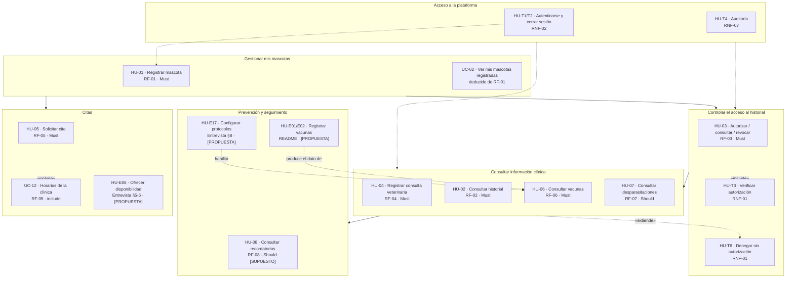

# PetCare — Historias de Usuario, Criterios de Aceptación y Trazabilidad

> **Qué documenta este archivo:** el trabajo realizado en la fase de *historias de usuario* de PetCare:
> qué historias existen, de dónde salen, cómo se validaron contra la metodología INVEST, qué criterios de
> aceptación tienen, cómo se relacionan con los requisitos (RF/RNF), con los casos de uso del diagrama
> [`petcare-casos-uso.drawio`](./petcare-casos-uso.drawio) y con los componentes de
> [`petcare-componentes.drawio`](./petcare-componentes.drawio), y qué falta por hacer.
>
> **Generado a partir de (fuente de verdad, en este orden):**
> 1. [`Ia/requisitos.md`](./Ia/requisitos.md) — RF-01…RF-08, RNF-01…RNF-08, HU-01…HU-08, Gherkin de HU-01
> 2. [`Ia/prompts.md`](./Ia/prompts.md) — método: INVEST (P2), Gherkin (P3), MoSCoW (P4), revisión y trazabilidad (P5)
> 3. [`Ia/entrevista.md`](./Ia/entrevista.md) — necesidades del cliente veterinario (§1–§16)
> 4. [`../README.md`](../README.md) — alcance MVP, expansiones y matriz de roles y permisos
> 5. [`petcare-casos-uso.drawio`](./petcare-casos-uso.drawio) — casos de uso `UC-01`…`UC-12`, `UC-T1`…`UC-T6` (MVP) y `UC-E01`…`UC-E24` (ampliado)

---

## 0. Resumen ejecutivo

| Métrica | Valor |
|---|---|
| Historias de usuario en la línea base | **8** (`HU-01`…`HU-08`), una por RF, sin combinar RF |
| Distribución MoSCoW | **6 Must** (`HU-01`…`HU-06`) · **2 Should** (`HU-07`, `HU-08`) |
| Actores con historia propia | `Propietario` (7 HU) · `Veterinario` (1 HU) |
| Casos de uso del MVP modelados | 12 (`UC-01`…`UC-12`) + 6 transversales (`UC-T1`…`UC-T6`) |
| Historias con Gherkin redactado | **1 de 8** (`HU-01`, 2 escenarios) → brecha **C-4** |
| Escenarios Gherkin propuestos aquí | **20** nuevos para `HU-02`…`HU-08` (todos `[PROPUESTA]`, pendientes de QA) |
| Historias transversales propuestas | 6 (`HU-T1`…`HU-T6`) derivadas de RNF, no del RF |
| Historias del alcance ampliado propuestas | 24 (`HU-E01`…`HU-E24`) = 1:1 con `UC-E01`…`UC-E24` |
| Contradicciones / brechas detectadas | 9 (H-1…H-9), 4 ya documentadas como C-1…C-4 |
| Estado del backlog | **Ready para Sprint 0** de los `Must`, salvo `HU-08` (requiere definir Actor y umbral) |

**Conclusión en una frase:** la línea base de historias está completa y trazable a nivel de RF, pero
**no está lista para desarrollar** porque 7 de 8 historias carecen de criterios de aceptación y
porque el alcance del producto real (README + entrevista) está todavía sin formalizar como historias.

---

## 1. Registro de trabajo: qué se hizo

| # | Fase | Método aplicado | Entrada | Salida | Artefacto | Estado |
|---|---|---|---|---|---|---|
| F1 | Levantamiento de requisitos | `prompts.md` P1 | entrevista + README | RF-01…RF-08, RNF-01…RNF-08 | `Ia/requisitos.md` | Hecho |
| F2 | **Historias de usuario INVEST** | `prompts.md` P2 | RF-01…RF-08 (fuente de verdad) | 8 historias `Como / quiero / para` + validación INVEST | `Ia/requisitos.md` §"Historias de usuario priorizadas con MoSCoW" | Hecho |
| F3 | Criterios de aceptación Gherkin | `prompts.md` P3 | RF-01…RF-08 + HU-01…HU-08 | Gherkin **solo para HU-01** (2 escenarios) | `Ia/requisitos.md` §"Criterios Gherkin — HU-01" | **Parcial** (C-4) |
| F4 | Priorización MoSCoW | `prompts.md` P4 | RF + HU | Prioridades Must/Should preservadas y justificadas | `Ia/requisitos.md` §"Análisis de requerimientos" | Hecho |
| F5 | Revisión y trazabilidad | `prompts.md` P5 | RF + RNF + HU + Gherkin | 7 contradicciones C-1…C-7 | `diagrama-componentes.md` §1.7 | Hecho |
| F6 | **Casos de uso UML** | Modelado UML | RF + RNF + HU | 2 páginas: 12 UC + 6 UC-T (MVP), 24 UC-E (ampliado) | `petcare-casos-uso.drawio` | Hecho |
| F7 | Componentes y arquitectura | Modelado UML + ADR | HF + UC | 2 páginas + documento de arquitectura | `petcare-componentes.drawio`, `diagrama-componentes.md` | Hecho |
| F8 | **Consolidación de historias** | Este documento | Todo lo anterior | Fichas HU, INVEST, Gherkin propuesto, trazabilidad, backlog | `docs/historias-usuario.md` | Hecho |

### 1.1 Reglas heredadas de los prompts y cómo se cumplieron

| Regla (de `prompts.md`) | Cumplimiento |
|---|---|
| Conservar exactamente los identificadores `RF-01`…`RF-08` | Sí, 8/8 |
| No crear RF nuevos | Sí — las 30 historias ampliadas se marcan `[PROPUESTA]` y **no** inventan RF |
| No combinar dos RF en una sola historia | Sí, salvo el error nº 3 de `RF-03` (H-2) |
| No agregar funcionalidades | Sí — nada de pagos, push ni chat en las historias de la línea base |
| No modificar prioridades | Sí — 6 Must / 2 Should, idénticas al RF |
| No convertir los RNF en historias independientes | Sí — los RNF se(modelaron) como `UC-T1`…`UC-T6` y se proponen como `HU-T*` separadas y transversales |
| Mantener el acceso clínico de `RF-03` **por mascota** | Sí — `UC-04/05/06` y `HU-03` son por mascota |
| Mantener en `RF-05` que la disponibilidad la ofrece la clínica | Sí — `UC-12` «Consultar horarios disponibles» es `«include»` de `UC-11` |
| Marcar `[SUPUESTO]` | Sí — `HU-08` (y `RF-08`, `RNF-04`) |
| Escenarios verificables sin detalles técnicos | Sí en HU-01; los nuevos de §6 se redactan con el mismo criterio |

---

## 2. Convenciones y plantilla

### 2.1 Formato de historia de usuario

```text
HU-XX · [Prioridad] · [Actor]
Como [rol], quiero [capacidad], para [beneficio].
```

| Campo | Regla |
|---|---|
| `ID` | `HU-01`…`HU-08` línea base · `HU-T1`…`HU-T6` transversales · `HU-E01`…`HU-E24` ampliación |
| Actor | Un **rol** del README, nunca una persona ("Como propietario", no "Como Ana") |
| Capacidad | Una sola capacidad por historia; si el RF trae varias, se divide (H-2) |
| Beneficio | El valor para el actor; no describe la solución |
| Trazabilidad | Toda HU declara su `RF`, su `UC`, su componente y su Gherkin |

### 2.2 Nomenclatura de prioridad

| Marca | Significado |
|---|---|
| **Must** | Sin esto el MVP no funciona |
| **Should** | Valorable, el MVP funciona sin ello |
| **Could** | Deseable, iteraciones posteriores |
| `[PROPUESTA]` | No proviene de un RF: se deduce del README, la entrevista o un RNF |
| `[SUPUESTO]` | El requisito original lo declaraba supuesto; no es compromiso verificable |
| `[DECISIÓN PROPUESTA]` | Elección de diseño que requiere validación del cliente |

---

## 3. Inventario de historias de usuario (línea base)

### 3.1 Tabla resumen

| HU | RF | Actor | Capacidad | Beneficio | Prioridad | Casos de uso | Componente | Gherkin |
|---|---|---|---|---|---|---|---|---|
| **HU-01** | RF-01 | Propietario | Registrar una mascota (nombre, especie, sexo, fnac, identificación) | Gestionar su información con un identificador único automático | **Must** | `UC-01`, `UC-02` | `B-06` Mascotas y Propietarios | 2 escenarios ✅ |
| **HU-02** | RF-02 | Propietario | Consultar el historial clínico de una mascota registrada | Conocer y dar seguimiento a su información veterinaria | **Must** | `UC-03` | `B-07` Historial Clínico | 3 escenarios `[PROPUESTA]` |
| **HU-03** | RF-03 | Propietario | Autorizar, consultar y revocar el acceso de veterinarios **por mascota** | Controlar qué veterinarios ven su información clínica | **Must** | `UC-04`, `UC-05`, `UC-06` | `B-03` Autorización | 4 escenarios `[PROPUESTA]` |
| **HU-04** | RF-04 | Veterinario **autorizado** | Registrar una consulta (fecha, motivo, diagnóstico, observaciones) | Mantener actualizado el historial de la mascota | **Must** | `UC-10` | `B-08` Consultas Veterinarias | 3 escenarios `[PROPUESTA]` |
| **HU-05** | RF-05 | Propietario | Seleccionar clínica, veterinario y horario **ofrecido por la clínica** | Confirmar automáticamente una cita veterinaria ⚠️ C-2 | **Must** | `UC-11` (+`UC-12`) | `B-11` Citas y Disponibilidad | 3 escenarios `[PROPUESTA]` |
| **HU-06** | RF-06 | Propietario | Consultar el registro de vacunas (fecha de aplicación y próxima recomendada) | Hacer seguimiento de la vacunación | **Must** | `UC-07` | `B-09` Vacunas y Desparasitaciones, `B-10` Motor de Protocolos | 2 escenarios `[PROPUESTA]` |
| **HU-07** | RF-07 | Propietario | Consultar el registro de desparasitaciones (fecha de tratamiento y próxima recomendada) | Seguimiento del cuidado preventivo | Should | `UC-08` | `B-09`, `B-10` | 2 escenarios `[PROPUESTA]` |
| **HU-08** | RF-08 | ⚠️ **sin actor explícito** | Consultar recordatorios de próximas vacunas y desparasitaciones | Seguimiento preventivo oportuno | Should `[SUPUESTO]` | `UC-09` | `B-12` Recordatorios, `B-13` Notificaciones, `B-20` Scheduler | 2 escenarios `[PROPUESTA]` |

### 3.2 Fichas por historia

#### HU-01 — Registrar mascota · Must

> Como **propietario**, quiero registrar una mascota proporcionando su nombre, especie, sexo, fecha de
> nacimiento y datos de identificación, para gestionar su información en PetCare y contar con un
> identificador único generado automáticamente por el sistema.

- **Casos de uso:** `UC-01` (registrar) y `UC-02` (ver mis mascotas, deducido del mismo RF).
- **Validación UC:** `UC-T5 Validar datos obligatorios` se extiende a `UC-01`; por eso el escenario 2 de Gherkin no es opcional.
- **Componente:** `B-06` (frontend `F-*` de formularios + repositorio de mascotas).
- **Dependencias:** `HU-T1` (autenticarse) — el Gherkin exige "ha iniciado sesión".
- **Criterios de aceptación:** los 2 escenarios de `requisitos.md` L62-83 (**única HU con Gherkin oficial**).
- **Tamaño propuesto** `[PROPUESTA]`: S (3 pts).

#### HU-02 — Consultar historial clínico · Must

> Como **propietario**, quiero consultar el historial clínico de una mascota registrada, para conocer y
> dar seguimiento a su información veterinaria.

- **Casos de uso:** `UC-03`, que **`«include»` `UC-T3 Verificar autorización`** y se **extiende** con `UC-T6 Denegar acceso`.
- **Restricción RNF-01:** solo el propietario y veterinarios autorizados; el Personal de Clínica queda fuera (C-1).
- **Componente:** `B-07` (lectura consolidada, multi-sede, solo con autorización).
- **Dependencias:** `HU-01` (la mascota debe estar registrada), `HU-T1`.
- **Tamaño propuesto** `[PROPUESTA]`: M (5 pts).

#### HU-03 — Autorizar, consultar y revocar acceso · Must ⚠️ contiene 3 capacidades

> Como **propietario**, quiero autorizar, consultar y revocar el acceso de veterinarios al historial
> clínico de cada una de mis mascotas, para controlar qué veterinarios pueden consultar su información clínica.

- **Casos de uso:** `UC-04` (autorizar), `UC-05` (consultar autorizaciones), `UC-06` (revocar).
  `UC-06` **`«include»` `UC-T4 Registrar actividad en auditoría`** (RNF-07); `UC-04` se extiende con `UC-T6`.
- **Granularidad:** el acceso es **por mascota**, no por rol (clave para el modelo RBAC + ABAC).
- **Componente:** `B-03` Autorización (permiso + `autorizaciones_historial`).
- **Dependencias:** `HU-01`, `HU-T1`. **Bloquea** `HU-04` (no se puede registrar consulta sin autorización).
- **Acción requerida (H-2):** dividir en `HU-03a` autorizar, `HU-03b` consultar, `HU-03c` revocar **sin cambiar el RF-03**.
- **Tamaño propuesto** `[PROPUESTA]`: L (8 pts) o M si se divide.

#### HU-04 — Registrar consulta veterinaria · Must

> Como **veterinario autorizado**, quiero registrar una consulta asociada a una mascota, incluyendo la
> fecha, el motivo, el diagnóstico y las observaciones, para mantener actualizado su historial clínico.

- **Caso de uso:** `UC-10`, que **`«include»` `UC-T3`** y **`«include»` `UC-T4`** (RNF-07); se **extiende** con `UC-T6`.
- **Precondición crítica:** "veterinario autorizado" ⇒ requiere una fila en `autorizaciones_historial` creada por `HU-03`.
- **Componente:** `B-08` + escritura en `B-07`.
- **Tamaño propuesto** `[PROPUESTA]`: M (5 pts).

#### HU-05 — Seleccionar clínica, veterinario y horario · Must ⚠️ contradicción C-2

> Como **propietario**, quiero seleccionar una clínica, un veterinario y un horario disponible ofrecido por
> la clínica, para confirmar automáticamente una cita veterinaria.

- **Casos de uso:** `UC-11`, que **`«include»` `UC-12 Consultar horarios disponibles`** (los ofrece la clínica).
- **Contradicción C-2:** el beneficio dice "confirmar automáticamente", pero `RF-05` solo dice "solicita".
  Resolución adoptada: **"automáticamente" = reserva atómica del cupo** (evita doble reserva), no confirmación de asistencia.
  Confirmar / cancelar / reprogramar quedan como `UC-E03`…`UC-E05` (ampliado, sin RF).
- **Componente:** `B-11` + caché de disponibilidad (`D-03`).
- **Tamaño propuesto** `[PROPUESTA]`: M (5 pts).

#### HU-06 — Consultar registro de vacunas · Must

> Como **propietario**, quiero consultar el registro de vacunas de una mascota, incluyendo la fecha de
> aplicación y la próxima fecha recomendada, para realizar el seguimiento de su vacunación.

- **Casos de uso:** `UC-07`, que **`«include»` `UC-T3`** (la lectura del registro requiere verificación de autorización).
- **Dependencia de datos:** la "próxima fecha recomendada" la calcula `B-10` a partir del protocolo.
  ⚠️ Nadie puede *escribir* ese registro (brecha H-3 → `UC-E01 Registrar aplicación de vacuna`).
- **Componentes:** `B-09` (lectura), `B-10` (cálculo).
- **Tamaño propuesto** `[PROPUESTA]`: S-M (3 pts).

#### HU-07 — Consultar registro de desparasitaciones · Should

> Como **propietario**, quiero consultar el registro de desparasitaciones de una mascota, incluyendo la
> fecha del tratamiento y la próxima fecha recomendada, para realizar el seguimiento de su cuidado preventivo.

- **Caso de uso:** `UC-08`, que **`«include»` `UC-T3`**.
- Es el gemelo de `HU-06`; mismo diseño, distinto dominio de datos.
- **Tamaño propuesto** `[PROPUESTA]`: S (2 pts) reutilizando `HU-06`.

#### HU-08 — Consultar recordatorios preventivos · Should `[SUPUESTO]` ⚠️ sin actor

> Como **propietario**, quiero consultar dentro de PetCare recordatorios sobre próximas vacunas y
> desparasitaciones, para realizar oportunamente el seguimiento preventivo de mi mascota.

- **Caso de uso:** `UC-09`, con una relación **`«genera»` desde el actor `Sistema (Scheduler)`** (`UC-T` B-20).
- **Problemas abiertos:** (a) el actor del *enunciado* es el propietario pero quien **genera** es el sistema;
  (b) "próxima fecha próxima" no tiene umbral numérico → no es verificable (H-5).
- **Componentes:** `B-20` Scheduler, `B-12` Recordatorios, `B-13` Notificaciones.
- **Tamaño propuesto** `[PROPUESTA]`: M (5 pts) — incluye el job diario.

---

## 4. Validación INVEST

Leyenda: ✅ cumple · ⚠️ cumple con observación · ❌ no cumple (requiere corrección antes de estimar).

| HU | I — Independent | N — Negotiable | V — Valuable | E — Estimable | S — Small | T — Testable | Veredicto |
|---|---|---|---|---|---|---|---|
| `HU-01` | ✅ Sin HU previa | ✅ El "para" es negociable | ✅ Identificador único + centralización | ✅ 2–3 días | ✅ 1 CRUD | ✅ 2 escenarios Gherkin | **Lista** |
| `HU-02` | ✅ Sin HU previa | ✅ | ✅ | ✅ 3–5 días | ✅ 1 lectura | ⚠️ Sin Gherkin oficial | **Lista con FFE.1** |
| `HU-03` | ✅ | ✅ | ✅ Alto valor (RNF-01) | ✅ 5–8 días | ❌ **3 capacidades en 1 historia** | ⚠️ Sin Gherkin oficial | **Dividir (H-2)** |
| `HU-04` | ❌ **Depende de `HU-03`** | ✅ | ✅ | ✅ 3–5 días | ✅ | ⚠️ "Autorizado" requiere estado verificable | **Bloqueada por HU-03** |
| `HU-05` | ✅ | ❌ "confirmar automáticamente" no es negociable tal como está | ✅ | ⚠️ Depende de resolver C-2 | ✅ | ⚠️ Sin Gherkin oficial | **Corregir C-2** |
| `HU-06` | ✅ | ✅ | ✅ | ✅ 2–3 días | ✅ | ⚠️ "próxima recomendada" requiere `B-10` | **Lista con FFE.1** |
| `HU-07` | ✅ | ✅ | ✅ | ✅ 2–3 días | ✅ | ⚠️ Ídem HU-06 | **Lista con FFE.1** |
| `HU-08` | ✅ | ⚠️ | ⚠️ Actor ambiguo | ❌ Umbral "próxima" sin definir | ✅ | ❌ `[SUPUESTO]` no verificable | **Definir actor + umbral** |

### 4.1 Fichas de calidad pendientes (FFE)

| ID | Falta | HU afectadas | Bloquea |
|---|---|---|---|
| **FFE.1** | Redactar y validar los criterios Gherkin (brecha C-4) | `HU-02`…`HU-08` | Estimación y QA |
| **FFE.2** | Dividir `HU-03` en tres historias | `HU-03`, `HU-04` | Sprint de planificación |
| **FFE.3** | Definir el umbral numérico de "próxima fecha" y el actor de `RF-08` | `HU-08` | Implementación |
| **FFE.4** | Reescribir el beneficio de `HU-05` según la resolución de C-2 | `HU-05` | QA |
| **FFE.5** | Decidir si el registro de vacunas/desparasitaciones entra al MVP (H-3) | `HU-06`, `HU-07`, `HU-E01`, `HU-E02` | Modelo de datos |

---

## 5. Criterios de aceptación y Gherkin

### 5.1 Cobertura actual

| HU | Escenarios oficiales | Escenarios propuestos en §5.2 | Flujos cubiertos |
|---|---|---|---|
| `HU-01` | 2 (`requisitos.md` L62-83) | — | Exitoso, datos incompletos |
| `HU-02` | 0 | 3 | Exitoso, mascota ajena (RNF-01), sin registros |
| `HU-03` | 0 | 4 | Autorizar, consultar autorizaciones, revocar, efecto de la revocación |
| `HU-04` | 0 | 3 | Exitoso, veterinario sin autorización, datos incompletos |
| `HU-05` | 0 | 3 | Exitoso, horario no ofrecido, sin disponibilidad |
| `HU-06` | 0 | 2 | Exitoso, sin vacunas registradas |
| `HU-07` | 0 | 2 | Exitoso, sin desparasitaciones registradas |
| `HU-08` | 0 | 3 | Generación, no generación sin vencimientos próximos, consulta de recordatorios |

**Total:** 2 oficiales + 20 propuestos = 22 escenarios para 8 historias.

### 5.2 Escenarios Gherkin propuestos para HU-02…HU-08 `[PROPUESTA]`

> Reglas aplicadas (idénticas a `prompts.md` P3): un solo RF por escenario, sin funcionalidades nuevas,
> sin reglas de negocio inventadas, criterios verificables sin detalles técnicos.
> El Gherkin **existente** de HU-01 no se modifica.

#### HU-02 — Consultar historial clínico

```gherkin
Scenario: Consultar el historial clínico de una mascota registrada
  Given que el propietario ha iniciado sesión
  And tiene una mascota registrada
  When consulta el historial clínico de esa mascota
  Then el sistema muestra los registros clínicos asociados a la mascota

Scenario: Denegar la consulta del historial de una mascota que no es del propietario
  Given que el propietario ha iniciado sesión
  And la mascota solicitada pertenece a otro propietario
  When intenta consultar su historial clínico
  Then el sistema deniega el acceso
  And no muestra ningún registro del historial clínico

Scenario: Consultar el historial de una mascota sin registros clínicos
  Given que el propietario ha iniciado sesión
  And su mascota registrada no tiene consultas asociadas
  When consulta el historial clínico de esa mascota
  Then el sistema informa que todavía no hay registros clínicos
```

#### HU-03 — Autorizar, consultar y revocar el acceso de veterinarios

```gherkin
Scenario: Autorizar el acceso de un veterinario al historial de una mascota
  Given que el propietario ha iniciado sesión
  And tiene una mascota registrada
  And existe un veterinario usuario de la plataforma
  When autoriza el acceso de ese veterinario al historial de esa mascota
  Then el sistema registra la autorización asociada a esa mascota y a ese veterinario

Scenario: Consultar las autorizaciones vigentes de mis mascotas
  Given que el propietario ha iniciado sesión
  And ha autorizado el acceso de un veterinario a una de sus mascotas
  When consulta sus autorizaciones vigentes
  Then el sistema muestra los veterinarios autorizados para cada una de sus mascotas

Scenario: Revocar el acceso de un veterinario
  Given que el propietario ha iniciado sesión
  And tiene una autorización vigente para un veterinario en una de sus mascotas
  When revoca esa autorización
  Then el sistema deja de considerar la autorización como vigente
  And registra la revocación en el registro de auditoría

Scenario: Impedir el acceso después de revocar la autorización
  Given que el propietario ha revocado el acceso de un veterinario a una mascota
  When ese veterinario intenta consultar el historial clínico de esa mascota
  Then el sistema deniega el acceso
  And no muestra ningún registro del historial clínico
```

#### HU-04 — Registrar consulta veterinaria

```gherkin
Scenario: Registrar una consulta de un veterinario autorizado
  Given que un veterinario tiene una autorización vigente para la mascota
  And ha iniciado sesión
  When registra una consulta con fecha, motivo, diagnóstico y observaciones
  Then el sistema asocia la consulta a esa mascota
  And la consulta queda visible en el historial clínico de la mascota

Scenario: Impedir el registro de un veterinario sin autorización vigente
  Given que un veterinario no tiene autorización vigente para la mascota
  And ha iniciado sesión
  When intenta registrar una consulta para esa mascota
  Then el sistema deniega la operación
  And no registra la consulta

Scenario: Registrar una consulta con datos obligatorios incompletos
  Given que un veterinario autorizado está registrando una consulta
  And falta el motivo o el diagnóstico
  When confirma el registro
  Then el sistema no registra la consulta
  And informa los datos que deben completarse
```

#### HU-05 — Seleccionar clínica, veterinario y horario

```gherkin
Scenario: Solicitar una cita con un horario ofrecido por la clínica
  Given que el propietario ha iniciado sesión
  And existe una clínica con un horario disponible para un veterinario
  When selecciona esa clínica, ese veterinario y ese horario
  Then el sistema registra la cita asociada a la mascota, la clínica y el veterinario
  And el horario deja de estar disponible para otros propietarios

Scenario: No permitir seleccionar un horario no ofrecido por la clínica
  Given que el propietario ha iniciado sesión
  And ese horario no está entre los ofrecidos por la clínica seleccionada
  When intenta seleccionarlo
  Then el sistema rechaza la selección
  And no registra ninguna cita

Scenario: Solicitar una cita cuando no hay horarios disponibles
  Given que el propietario ha iniciado sesión
  And la clínica no tiene horarios disponibles
  When intenta solicitar una cita
  Then el sistema informa que no hay horarios disponibles
  And no registra ninguna cita
```

#### HU-06 — Consultar registro de vacunas

```gherkin
Scenario: Consultar el registro de vacunas con próxima fecha recomendada
  Given que el propietario ha iniciado sesión
  And su mascota registrada tiene una aplicación de vacuna con fecha de aplicación
  When consulta el registro de vacunas de esa mascota
  Then el sistema muestra la fecha de aplicación de la vacuna
  And muestra la próxima fecha recomendada

Scenario: Consultar el registro de vacunas de una mascota sin vacunas registradas
  Given que el propietario ha iniciado sesión
  And su mascota no tiene vacunas registradas
  When consulta el registro de vacunas de esa mascota
  Then el sistema informa que no hay vacunas registradas
```

#### HU-07 — Consultar registro de desparasitaciones

```gherkin
Scenario: Consultar el registro de desparasitaciones con próxima fecha recomendada
  Given que el propietario ha iniciado sesión
  And su mascota registrada tiene un tratamiento de desparasitación con fecha de tratamiento
  When consulta el registro de desparasitaciones de esa mascota
  Then el sistema muestra la fecha del tratamiento
  And muestra la próxima fecha recomendada

Scenario: Consultar el registro de desparasitaciones de una mascota sin tratamientos
  Given que el propietario ha iniciado sesión
  And su mascota no tiene desparasitaciones registradas
  When consulta el registro de desparasitaciones de esa mascota
  Then el sistema informa que no hay desparasitaciones registradas
```

#### HU-08 — Consultar recordatorios preventivos `[SUPUESTO]`

```gherkin
Scenario: Generar recordatorios de vacunas y desparasitaciones próximas
  Given que existen registros con una próxima fecha recomendada próxima
  When el sistema ejecuta la generación de recordatorios
  Then el sistema genera un recordatorio por cada registro con próxima fecha próxima

Scenario: No generar recordatorios cuando no hay vencimientos próximos
  Given que no existen registros con una próxima fecha recomendada próxima
  When el sistema ejecuta la generación de recordatorios
  Then el sistema no genera ningún recordatorio

Scenario: El propietario consulta sus recordatorios preventivos
  Given que el propietario ha iniciado sesión
  And tiene recordatorios generados
  When consulta sus recordatorios
  Then el sistema muestra los recordatorios de vacunas y desparasitaciones de sus mascotas
```

> ⚠️ El concepto **"próxima fecha próxima"** sigue sin umbral numérico (FFE.3). Mientras no se defina
> (p. ej. *días de anticipación configurables*), el escenario 1 no es automatizable.

---

## 6. Trazabilidad

### 6.1 RF → HU → UC → Gherkin → Prioridad (formato Prompt 5)

| Requisito | Historia | Casos de uso | Criterios Gherkin | Prioridad | Estado |
|---|---|---|---|---|---|
| RF-01 | `HU-01` | `UC-01`, `UC-02` | 2 oficiales | Must | Completa |
| RF-02 | `HU-02` | `UC-03` | 3 `[PROPUESTA]` | Must | Completa tras FFE.1 |
| RF-03 | `HU-03` | `UC-04`, `UC-05`, `UC-06` | 4 `[PROPUESTA]` | Must | Dividir (FFE.2) |
| RF-04 | `HU-04` | `UC-10` | 3 `[PROPUESTA]` | Must | Bloqueada por `HU-03` |
| RF-05 | `HU-05` | `UC-11`, `UC-12` | 3 `[PROPUESTA]` | Must | Corregir C-2 (FFE.4) |
| RF-06 | `HU-06` | `UC-07` | 2 `[PROPUESTA]` | Must | Completa tras FFE.1 |
| RF-07 | `HU-07` | `UC-08` | 2 `[PROPUESTA]` | Should | Completa tras FFE.1 |
| RF-08 | `HU-08` | `UC-09` | 3 `[PROPUESTA]` | Should `[SUPUESTO]` | Definir umbral (FFE.3) |

### 6.2 RNF → dónde se refleja

| RNF | Historias / Casos de uso | Componente | Estado |
|---|---|---|---|
| RNF-01 (restricción del historial) | `HU-02`, `HU-03`, `HU-04` · `UC-T3`, `UC-T6` | `B-03` Autorización | Cubierto |
| RNF-02 (credenciales y datos personales) | `HU-T1`, `HU-T2` · `UC-T1`, `UC-T2` | `B-02` Autenticación | Sin historia propia → `HU-T1/T2` |
| RNF-03 (integridad de la información clínica) | `UC-T6`, escritura de `UC-10` | `B-03`, `B-21` | Cubierto por permiso + transacciones |
| RNF-04 (tiempo de respuesta) `[SUPUESTO]` | Restricción transversal, sin UC propio | `D-03` Redis, `D-05` | ⚠️ Falta valor medible (ver §9.1 de `diagrama-componentes.md`) |
| RNF-05 (navegadores y responsive) | Restricción transversal | `F-*` (PWA responsive) | Sin HU |
| RNF-06 (usabilidad sin conocimientos técnicos) | Criterio transversal de todas las HU | `F-*` | Sin HU |
| RNF-07 (trazabilidad de operaciones) | `UC-T4` ← `«include»` de `UC-06` y `UC-10` | `B-*` (auditoría) | Parcial: solo esos dosUC |
| RNF-08 (respaldo y recuperación) | No aplica a historias | `D-02`, `D-04` | Infraestructura |

### 6.3 Historias → casos de uso → componente

| HU | Actor | Casos de uso | Componente backend | RF |
|---|---|---|---|---|
| `HU-01` | Propietario | `UC-01`, `UC-02` | `B-06` | RF-01 |
| `HU-02` | Propietario | `UC-03` | `B-07` | RF-02 |
| `HU-03` | Propietario | `UC-04`, `UC-05`, `UC-06` | `B-03` | RF-03 |
| `HU-04` | Veterinario | `UC-10` | `B-08` | RF-04 |
| `HU-05` | Propietario | `UC-11`, `UC-12` | `B-11` | RF-05 |
| `HU-06` | Propietario | `UC-07` | `B-09` + `B-10` | RF-06 |
| `HU-07` | Propietario | `UC-08` | `B-09` + `B-10` | RF-07 |
| `HU-08` | Propietario + Scheduler | `UC-09` | `B-12`, `B-13`, `B-20` | RF-08 |

---

## 7. Problemas encontrados y correcciones

| ID | Elemento | Problema | Severidad | Corrección propuesta |
|---|---|---|---|---|
| **H-1** | Cobertura de Gherkin | Solo `HU-01` tiene criterios; 7 historias sin criterio verificable (ya **C-4**) | 🔴 Alta | Redactar y validar los 20 escenarios de §5.2 antes de estimar (FFE.1) |
| **H-2** | `RF-03` / `HU-03` | Un RF con **tres capacidades** (autorizar, consultar, revocar) genera una historia que viola INVEST *Small* | 🔴 Alta | Dividir en `HU-03a/b/c` manteniendo el RF-03 como origen (FFE.2) |
| **H-3** | Vacunas y desparasitaciones | El README asigna al veterinario el **registro** de vacunas y desparasitaciones, pero ningún RF lo cubre; `HU-06/07` solo **consultan** un dato que nadie escribe | 🔴 Alta | Decidir si entra al MVP: promover `UC-E01`/`UC-E02` → historias `HU-E01`/`HU-E02` con RF propio (FFE.5) |
| **H-4** | `HU-05` vs `RF-05` | "confirmar automáticamente" contradice el RF y el README define confirmar/cancelar/reprogramar como acciones separadas (ya **C-2**) | 🟠 Media | Reescribir el beneficio como "reserva automática del cupo" (FFE.4) |
| **H-5** | `HU-08` / `RF-08` | Actor ambiguo y "próxima fecha próxima" **sin umbral**: no es testeable; además es `[SUPUESTO]` | 🟠 Media | Definir actor (propietario receptor, sistema generador) y días de anticipación |
| **H-6** | Cobertura de RNF | `RNF-02` (autenticación) no tiene historia; toda HU asume "ha iniciado sesión" | 🟠 Media | Incorporar `HU-T1`/`HU-T2` como historias transversales |
| **H-7** | `HU-04` | El Gherkin necesita el estado "veterinario autorizado", que solo existe si `HU-03` se implementó antes | 🟡 Baja | Historias en este orden dentro del sprint: `HU-03` → `HU-04` |
| **H-8** | `Ia/requisitos.md` | La tabla de RF está **duplicada** (§1 y §"Análisis de requerimientos") y el encabezado es `## ## Historias de usuario...`; además el enlace L4 apunta a `./ia/entrevista.md` y la carpeta real es `Ia` (falla en Linux/macOS) (ya **C-5**) | 🟡 Baja | Dejar una sola tabla de RF, corregir encabezados y la ruta del enlace |
| **H-9** | Alcance del producto | 24 capacidades del README y de la entrevista **no tienen historia** (citas, agenda, documentos, dashboard, QR, lista de espera, IA, auditoría, usuarios/sedes) (ya **C-3**) | 🟠 Media | No se inventan RF: se registran como `HU-E01`…`HU-E24` `[PROPUESTA]` (§8) |

---

## 8. Historias de usuario del alcance ampliado `[PROPUESTA]`

No provienen de ningún RF: se derivan del README y de la entrevista. Coinciden 1:1 con la segunda
página de `petcare-casos-uso.drawio` (`UC-E01`…`UC-E24`) y con los componentes `B-10`…`B-19`.
**No deben implementarse sin formalizar antes el RF correspondiente.**

| HU | UC | Actor(es) | Enunciado (Como / quiero / para) | Origen | Prioridad sugerida |
|---|---|---|---|---|---|
| `HU-E01` | `UC-E01` | Veterinario | registrar una aplicación de vacuna en una mascota, para mantener el registro de vacunación actualizado | README MVP | **Must** (si se cierra H-3) |
| `HU-E02` | `UC-E02` | Veterinario | registrar una desparasitación en una mascota, para mantener el registro preventivo actualizado | README MVP | **Must** (si se cierra H-3) |
| `HU-E03` | `UC-E03` | Propietario | confirmar una cita solicitada, para asegurar la asistencia de mi mascota | README MVP · C-2 | Should |
| `HU-E04` | `UC-E04` | Propietario | cancelar una cita, para liberar el cupo ante un imprevisto | README MVP · C-2 | Should |
| `HU-E05` | `UC-E05` | Propietario | reprogramar una cita, para cambiar la fecha sin perder la reserva | README MVP · C-2 | Should |
| `HU-E06` | `UC-E06` | Personal de Clínica | administrar la disponibilidad de horarios de la clínica, para ofrecer cupos reales a los propietarios | Entrevista §5, §6 · RF-05 | **Must** (habilita `HU-05`) |
| `HU-E07` | `UC-E07` | Personal de Clínica | ver la agenda y gestionar el estado de las citas, para operar la agenda del día | Entrevista §6 | Should |
| `HU-E08` | `UC-E08` | Personal de Clínica | consultar los próximos vencimientos, para priorizar la atención preventiva | README MVP | Should |
| `HU-E09` | `UC-E09` | Personal de Clínica | aprobar o postergar un recordatorio, para ajustar el contacto con el propietario | README MVP · extiende `UC-E08` | Should |
| `HU-E10` | `UC-E10` | Veterinario | adjuntar un documento o examen a una mascota, para conservar la evidencia clínica | Entrevista §3 | Should |
| `HU-E11` | `UC-E11` | Propietario | consultar y descargar los documentos de una mascota, para compartir resultados | README Should | Should |
| `HU-E12` | `UC-E12` | Veterinario | generar la fórmula o el resumen de una consulta, para entregar una instrucción al propietario | Entrevista §12 | Should |
| `HU-E13` | `UC-E13` | Veterinario, Personal de Clínica | buscar un paciente por nombre o identificación, para atender rápido en consulta | Entrevista §11 | Should |
| `HU-E14` | `UC-E14` | Personal de Clínica, Administrador | ver el dashboard y los indicadores por sede, para tomar decisiones operativas | Entrevista §10 | Should |
| `HU-E15` | `HU-E15` | Administrador | administrar usuarios, roles y sedes, para mantener la plataforma al día | Entrevista §7 | Must (soporte) |
| `HU-E16` | `UC-E16` | Administrador | activar o desactivar un usuario de inmediato, para responder a incidentes de seguridad | Entrevista §13 · extiende `HU-E15` | Should |
| `HU-E17` | `HU-E17` | Administrador, Veterinario | configurar los protocolos preventivos, para calcular correctamente la próxima fecha de refuerzo | Entrevista §8 | **Must** (habilita `HU-06/07`) |
| `HU-E18` | `UC-E18` | Administrador | consultar el registro de auditoría, para rastrear operaciones sobre datos clínicos | RNF-07 | Must (RNF-07) |
| `HU-E19` | `UC-E19` | Propietario | participar en la lista de espera, para obtener un cupo cuando se libere un horario | README Should | Could |
| `HU-E20` | `UC-E20` | Propietario | ver el perfil de emergencia de mi mascota mediante un código QR, para que quien la atienda tenga sus datos básicos | README Could | Could |
| `HU-E21` | `UC-E21` | Propietario | recibir una alerta preventiva generada por IA, para actuar antes de un preventable | README Could · solo *advisory* | Could |
| `HU-E22` | `UC-E22` | Veterinario | analizar la tendencia de peso de una mascota con IA, para detectar desvíos | README Could · extiende `HU-E21` · requiere autorización expresa | Could |
| `HU-E23` | `UC-E23` | Propietario, Personal de Clínica | consultar el historial multi-sede, para no depender de la sede donde se atendió | Entrevista §4 | Should |
| `HU-E24` | `HU-E24` | Administrador | administrar sedes y veterinarios, para operar la red de clínicas | Entrevista §7 | Should |

---

## 9. Historias transversales `[PROPUESTA]`

Derivadas de los RNF (los prompts prohíben convertir RNF en historias de la línea base, por lo que se
registran aparte). Corresponden 1:1 con `UC-T1`…`UC-T6` del diagrama de casos de uso.

| HU | UC | RNF | Enunciado | Actor |
|---|---|---|---|---|
| `HU-T1` | `UC-T1` | RNF-02 | Como usuario de PetCare, quiero autenticarme con credenciales protegidas, para acceder a mis datos sin exponerlos | `Usuario PetCare` |
| `HU-T2` | `UC-T2` | RNF-02 | Como usuario de PetCare, quiero cerrar sesión, para no dejar el acceso abierto en un dispositivo compartido | `Usuario PetCare` |
| `HU-T3` | `UC-T3` | RNF-01, RF-03 | Como sistema, quiero verificar la autorización vigente antes de devolver un historial clínico, para que solo quien está autorizado lo vea | transversal |
| `HU-T4` | `UC-T4` | RNF-07 | Como administrador, quiero que cada operación relevante sobre información clínica quede auditada, para garantizar la trazabilidad | transversal |
| `HU-T5` | `UC-T5` | Gherkin HU-01 esc. 2 | Como sistema, quiero validar los datos obligatorios antes de guardar, para evitar registros incompletos | transversal |
| `HU-T6` | `UC-T6` | RNF-01 | Como sistema, quiero denegar el acceso cuando no exista autorización, para proteger el historial clínico de la mascota | transversal |

> `HU-T5` y `HU-T6` **no son historias nuevas**: son la extracción de los escenarios 2 de `HU-01` y de
> los escenarios de denegación de `HU-02`/`HU-03`/`HU-04`, para que la regla se implemente una sola vez.

---

## 10. Mapa de historias (Story Map)



**Lectura del mapa:** el camino crítico del MVP es
`HU-T1 → HU-01 → HU-03 → HU-04 → HU-02`, y `HU-06/HU-07` dependen de que exista un registro escrito
(`HU-E01/E02`), que hoy es la brecha H-3.

---

## 11. Priorización MoSCoW de las historias

| Grupo | Historias | Justificación |
|---|---|---|
| **Must** | `HU-01`, `HU-02`, `HU-03`, `HU-04`, `HU-05`, `HU-06` | Sin registro de mascota no hay nada que consultar; sin control de acceso el RNF-01 se incumple; sin registro de consulta el historial nunca crece; sin citas no hay atención; `HU-06` es el núcleo de "cuidado preventivo" |
| **Should** | `HU-07`, `HU-08` | Aportan al seguimiento pero el sistema funciona sin ellos (`HU-07` es gemela de `HU-06`; `HU-08` es `[SUPUESTO]`) |
| **Could** | `HU-E19`…`HU-E22` (y el resto de `HU-E*`) | Optimización y expansión; el README las ubica en *Should*/*Could* y ninguna tiene RF |
| **Won't (esta iteración)** | Pagos, notificaciones push, chat, facturación, integración con laboratorio | Prohibido explícitamente por `prompts.md`; el framework tiene chat pero **no** se conecta (brecha B-5) |

### 11.1 Orden de implementación sugerido

```text
Sprint 0 — Cimientos:        HU-T1, HU-T2, HU-T3, HU-T5, HU-T6, HU-T4
Sprint 1 — Mascotas:         HU-01
Sprint 2 — Acceso:           HU-03a, HU-03b, HU-03c
Sprint 3 — Clínico:          HU-04, HU-02
Sprint 4 — Preventivo:       HU-E17, HU-E01, HU-E02, HU-06, HU-07
Sprint 5 — Citas:            HU-E06, HU-05
Sprint 6 — Recordatorios:    HU-08   (tras definir el umbral, FFE.3)
```

---

## 12. Definition of Ready y Definition of Done

### 12.1 Definition of Ready (una HU puede entrar a Sprint)

- [ ] Tiene `ID`, actor, capacidad, beneficio y prioridad MoSCoW
- [ ] Declara su `RF` de origen o está marcada `[PROPUESTA]`
- [ ] Está enlazada al menos a un caso de uso del diagrama
- [ ] Tiene criterios de aceptación en Gherkin revisados por QA
- [ ] No depende de otra HU sin ordenar, o la dependencia está explícita
- [ ] Pasa la validación INVEST
- [ ] No introduce funcionalidades fuera del alcance acordado

### 12.2 Definition of Done (una HU está terminada)

- [ ] Los escenarios Gherkin pasan en la suite automatizada
- [ ] Los criterios de `RNF` asociados están verificados (permisos, auditoría, validación)
- [ ] La HU respeta la matriz de permisos del README, con la corrección de **C-1** aplicada
- [ ] El caso de uso y el componente afectado están actualizados en los diagramas
- [ ] No se introducen datos de pacientes en logs ni en el framework de IA

---

## 13. Backlog de completitud: qué falta

| # | Tarea | Responsable | Bloquea |
|---|---|---|---|
| 1 | Validar los 20 escenarios `[PROPUESTA]` de §5.2 con QA | QA + cliente | Todo el Sprint 1 |
| 2 | Dividir `HU-03` en tres historias sin tocar `RF-03` (FFE.2) | Analista | `HU-04` |
| 3 | Resolver C-2 y reescribir el beneficio de `HU-05` (FFE.4) | Cliente | `HU-05` |
| 4 | Definir actor y umbral de anticipación de `RF-08` (FFE.3) | Cliente | `HU-08` |
| 5 | Decidir el alcance de H-3: ¿registro de vacunas/desparasitaciones en el MVP? | Cliente | `HU-06`, `HU-07` |
| 6 | Promover las `HU-E*` que se aprueben a historias con RF propio | Analista | Incremento 2 |
| 7 | Corregir H-8 en `Ia/requisitos.md` (tabla duplicada, encabezado `## ##`, ruta `./ia/`) | Analista | — |
| 8 | Asignar el actor de `Sistema (Scheduler)` en `HU-08` | Analista | `HU-08` |

---

## 14. Registro de cambios de este documento

| Fecha | Cambio |
|---|---|
| 2026-10-04 | Creación del documento. Se consolidan las 8 HU de `Ia/requisitos.md`, los casos de uso de `petcare-casos-uso.drawio`, la validación INVEST, 20 escenarios Gherkin propuestos, la trazabilidad RF→HU→UC→Gherkin→componente, las historias transversales `HU-T1…HU-T6` y las ampliadas `HU-E01…HU-E24`, y 9 hallazgos (H-1…H-9). |

---

## Referencias

| Documento | Relación |
|---|---|
| [`Ia/requisitos.md`](./Ia/requisitos.md) | Origen de RF, RNF, HU y Gherkin oficial |
| [`Ia/prompts.md`](./Ia/prompts.md) | Método aplicado (INVEST, Gherkin, MoSCoW, trazabilidad) |
| [`Ia/entrevista.md`](./Ia/entrevista.md) | Necesidades del cliente que originan las `HU-E*` |
| [`petcare-casos-uso.drawio`](./petcare-casos-uso.drawio) | Casos de uso `UC-01`…`UC-12`, `UC-T1`…`UC-T6`, `UC-E01`…`UC-E24` |
| [`petcare-componentes.drawio`](./petcare-componentes.drawio) | Componentes `B-02`…`B-21` y `D-01`…`D-05` |
| [`diagrama-componentes.md`](./diagrama-componentes.md) | Contradicciones C-1…C-7, arquitectura y componentes citados aquí |
| [`../README.md`](../README.md) | Alcance del MVP, expansiones y matriz de roles y permisos |